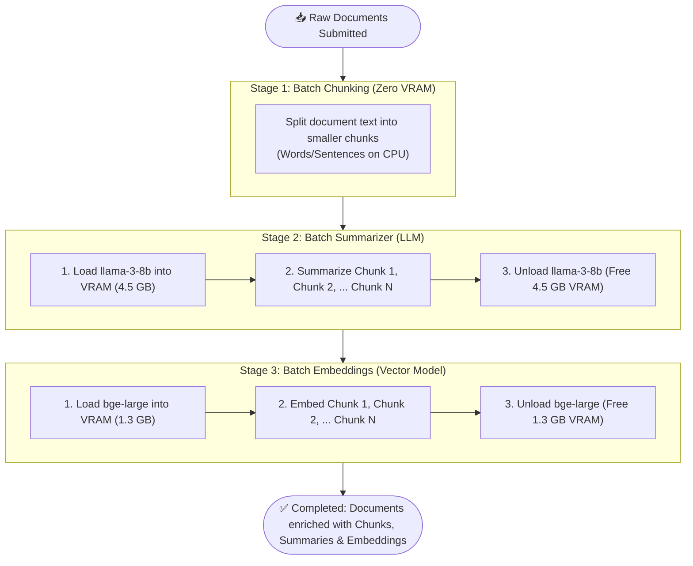

# Local AI Batch Pipeline: Simplified Architecture & Flow

This document explains **why** and **how** the staged batch pipeline works in simple, practical terms without overwhelming technical jargon.

---

## 🍳 The Core Problem: The "Small Kitchen" Analogy

Imagine you are a chef working in a kitchen with a **very small counter**:
* The counter can only fit **one heavy appliance** at a time.
* You have a **Heavy Blender** (4.5 GB LLM for summarization) and a **Heavy Food Processor** (1.3 GB Embedding model for vector search).
* You have 5 recipes (documents) to prepare.

### The Wrong Way: One Recipe at a Time (Item-by-Item)
1. Drag the 4.5 GB Blender onto the counter.
2. Blend Recipe 1.
3. Put the Blender away into the cupboard.
4. Drag the 1.3 GB Food Processor onto the counter.
5. Process Recipe 1.
6. Put the Food Processor away.
7. Repeat this whole cycle for Recipe 2, 3, 4, and 5!

> **The Result:** You spend 90% of your time sweating, moving heavy appliances back and forth off the shelf (SSD to RAM/VRAM). The computer thrashes memory and grinds to a crawl.

---

### The Right Way: Staged Batch (Bulk Execution)
1. **Stage 1 (Prep work / Chunking):** Chop all vegetables for all 5 recipes on the cutting board (Pure CPU text segmentation, 0 MB VRAM).
2. **Stage 2 (Summarization):**
   * Drag the **Blender** onto the counter **ONCE**.
   * Blend **all chunks from all 5 recipes** one after another.
   * Put the Blender away.
3. **Stage 3 (Embedding):**
   * Drag the **Food Processor** onto the counter **ONCE**.
   * Process **all chunks from all 5 recipes** one after another.
   * Put the Food Processor away.

> **The Result:** You only load each heavy model from disk into VRAM **exactly once**! Zero memory swapping, maximum GPU/NPU utilization, and blazing fast processing.

---

## 🔄 Visual Pipeline Flow

Here is the exact lifecycle of a batch request through the pipeline:



---

## 🧠 Memory Invariant: What Happens to VRAM?

At any given moment, the amount of memory allocated strictly respects your hardware limits:

| Pipeline Stage | Active Model | VRAM Allocated | Status |
| :--- | :--- | :--- | :--- |
| **Start** | *None* | `0 MB` | Clean state |
| **Stage 1: Chunking** | *None* | `0 MB` | Pure CPU string manipulation |
| **Stage 2: Summarizer** | `llama-3-8b` | `4,500 MB` | Model loaded once, processes all chunks |
| **Between Stages** | *None* | `0 MB` | Model evicted before next stage |
| **Stage 3: Embeddings** | `bge-large` | `1,300 MB` | Model loaded once, processes all chunks |
| **Finish** | *None* | `0 MB` | Memory cleanly restored |

---

## 🛡️ Clean Architecture: The "Jacket" Analogy

Why isn't our stage code cluttered with OpenTelemetry code?

Think of your pipeline stage as an **athlete running a marathon**:
* The athlete's job is purely to run (**pure business logic**).
* If the athlete had to stop every 10 meters, pull out a notepad, write down their heart rate and GPS coordinates, they couldn't run effectively.
* Instead, they put on a **smart watch** (the **Telemetry Decorator**).
* The watch automatically measures their pulse, speed, and distance **without the athlete changing how they run**.

### What the Pure Business Code Looks Like:
```go
func (p *BatchSummarizerPipeline) Run(ctx context.Context, params *request.FilterParams) error {
    docs, _ := batch.GetDocuments(params)

    // 1. Ask ModelManager to load model into VRAM
    release, err := p.modelManager.LoadModel(ctx, "llama-3-8b.gguf", 4_500_000_000)
    if err != nil {
        return err
    }
    defer release(ctx) // Automatically frees memory when this stage finishes!

    // 2. Process all chunks in bulk
    for _, doc := range docs {
        for i := range doc.Chunks {
            p.summarizer.SummarizeChunk(ctx, &doc.Chunks[i])
        }
    }
    return nil
}
```
> Notice: **Zero OpenTelemetry imports!** No spans, no tracer variables, no metrics counters inside the business logic.

---

## 🌳 What the OpenTelemetry Trace Looks Like

When you open **Jaeger** or inspect the trace logs, you see a clean, intuitive parent-child tree:

```
[Span] pipeline.workflow: local-ai-staged-workflow (Root: Entire Pipeline)
  │
  ├── [Span] pipeline.stage.chunking.batch (Duration: 5ms)
  │     └── Attributes: batch.document_count=3, batch.chunks_generated=5
  │
  ├── [Span] pipeline.stage.summarizer.batch (Duration: 250ms)
  │     │
  │     ├── [Child Span] ai.model.load (llama-3-8b-instruct.gguf, 4.5 GB, metal)
  │     │
  │     ├── [Child Span] pipeline.chunk.summarize (Doc 1, Chunk 0)
  │     │     └── Attributes: gen_ai.usage.input_tokens=38, gen_ai.usage.output_tokens=24
  │     ├── [Child Span] pipeline.chunk.summarize (Doc 1, Chunk 1)
  │     │     └── Attributes: gen_ai.usage.input_tokens=42, gen_ai.usage.output_tokens=28
  │     ├── [Child Span] pipeline.chunk.summarize (Doc 2, Chunk 0)
  │     │     └── Attributes: gen_ai.usage.input_tokens=35, gen_ai.usage.output_tokens=22
  │     │
  │     └── [Child Span] ai.model.unload (freed 4.5 GB)
  │
  └── [Span] pipeline.stage.embeddings.batch (Duration: 180ms)
        │
        ├── [Child Span] ai.model.load (bge-large-en-v1.5.gguf, 1.3 GB, metal)
        │
        ├── [Child Span] pipeline.chunk.embed (Doc 1, Chunk 0)
        │     └── Attributes: gen_ai.response.dimensions=768
        ├── [Child Span] pipeline.chunk.embed (Doc 1, Chunk 1)
        │     └── Attributes: gen_ai.response.dimensions=768
        ├── [Child Span] pipeline.chunk.embed (Doc 2, Chunk 0)
        │     └── Attributes: gen_ai.response.dimensions=768
        │
        └── [Child Span] ai.model.unload (freed 1.3 GB)
```

---

## 📈 The Metrics You Can Query in Prometheus

1. **`ai.model.vram_allocated_bytes` (Gauge)**:
   * Shows a square-wave graph in Grafana/Prometheus showing memory spikes matching the exact model size, dropping to 0 between stages.
2. **`ai.model.load_duration_ms` (Histogram)**:
   * How many milliseconds it takes to load weights from disk into memory.
3. **`gen_ai.client.token.usage` (Counter)**:
   * Standard OpenTelemetry GenAI metric with attributes:
     * `gen_ai.token.type`: `"input"` vs `"output"`
     * `gen_ai.request.model`: `"llama-3-8b-instruct.gguf"`
4. **`pipeline.batch.stage.duration_ms` (Histogram)**:
   * Total time spent in chunking vs summarizer vs embeddings.

---

## 💡 Summary of Key Takeaways

1. **Batching is essential for local AI**: Swapping models per-document destroys performance. Swapping models per-stage makes it practical on limited VRAM.
2. **ModelManager is the traffic cop**: It ensures that loading Model B will safely and automatically evict Model A first.
3. **Defer release(ctx) is your safety net**: Even if an error happens halfway through summarizing, Go's `defer` guarantees the 4.5 GB model is evicted from VRAM.
4. **Decorators keep code clean**: Your stage functions do pure data processing; the telemetry decorators handle all trace spans, attributes, and metric counters.
