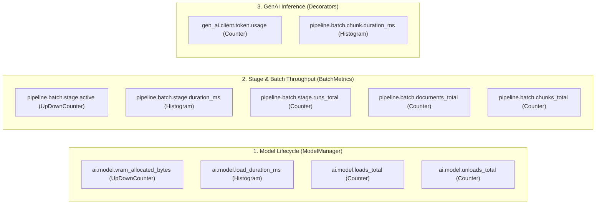
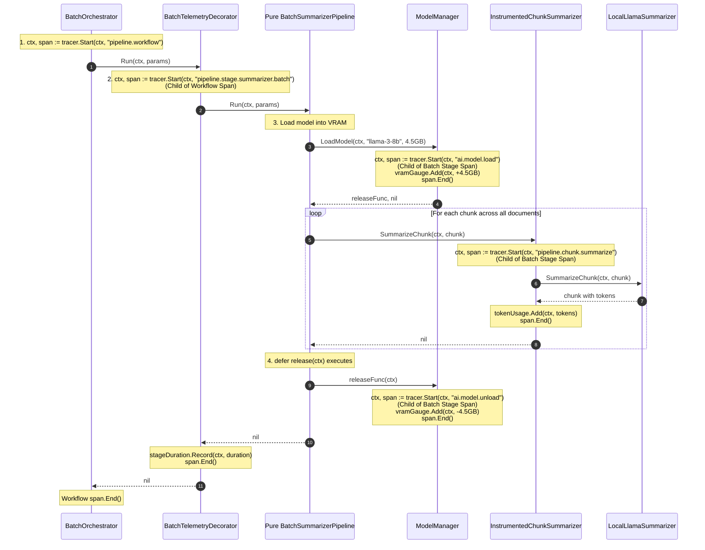

# OpenTelemetry Architecture for the Local AI Batch Pipeline

This document explains the complete OpenTelemetry observability architecture implemented around the memory-constrained local AI batch pipeline. It covers the **trace hierarchy**, **semantic conventions**, **metric instruments**, and the **flow of Go context**.

---

## 1. Tracing Architecture: The 4-Level Span Hierarchy

When processing documents in bulk, telemetry is organized into four nested levels:

```
Level 1: Workflow Span (Root)
  └── Level 2: Batch Stage Span (Per Pipeline Stage)
        ├── Level 3: Model Lifecycle Spans (Load / Unload)
        └── Level 4: Chunk Inference Spans (Per Document Chunk)
```

### Visual Trace Tree (As seen in Jaeger / Tempo)

```
[TraceID: ccf463f96fd6b24273d92b5f60e9827d]
│
└── 🌐 pipeline.workflow: local-ai-staged-workflow (Root Span)
    │   Attributes: pipeline.batch.document_count=3, pipeline.workflow.stage_count=3
    │
    ├── 📦 pipeline.stage.chunking.batch (Stage 1)
    │     ├── Attributes: pipeline.stage="chunking", pipeline.batch.final_chunk_count=5
    │     └── (Pure CPU text segmentation across all 3 documents on host)
    │
    ├── 📦 pipeline.stage.summarizer.batch (Stage 2)
    │     │
    │     ├── 🔄 ai.model.load
    │     │     Attributes: model.name="llama-3-8b-instruct.gguf", model.size_bytes=4500000000, device.type="metal"
    │     │
    │     ├── 💬 pipeline.chunk.summarize [Doc: doc-001, Chunk: 000]
    │     │     Attributes: gen_ai.system="llama.cpp", gen_ai.request.model="llama-3-8b-instruct.gguf",
    │     │                 gen_ai.usage.input_tokens=38, gen_ai.usage.output_tokens=24
    │     ├── 💬 pipeline.chunk.summarize [Doc: doc-001, Chunk: 001]
    │     │     Attributes: gen_ai.usage.input_tokens=42, gen_ai.usage.output_tokens=28
    │     ├── 💬 pipeline.chunk.summarize [Doc: doc-002, Chunk: 000]
    │     │     Attributes: gen_ai.usage.input_tokens=35, gen_ai.usage.output_tokens=22
    │     ├── 💬 pipeline.chunk.summarize [Doc: doc-002, Chunk: 001]
    │     │     Attributes: gen_ai.usage.input_tokens=40, gen_ai.usage.output_tokens=25
    │     ├── 💬 pipeline.chunk.summarize [Doc: doc-003, Chunk: 000]
    │     │     Attributes: gen_ai.usage.input_tokens=36, gen_ai.usage.output_tokens=21
    │     │
    │     └── 🔄 ai.model.unload
    │           Attributes: model.name="llama-3-8b-instruct.gguf", model.freed_bytes=4500000000
    │
    └── 📦 pipeline.stage.embeddings.batch (Stage 3)
          │
          ├── 🔄 ai.model.load
          │     Attributes: model.name="bge-large-en-v1.5.gguf", model.size_bytes=1300000000, device.type="metal"
          │
          ├── 📐 pipeline.chunk.embed [Doc: doc-001, Chunk: 000]
          │     Attributes: gen_ai.system="llama.cpp", gen_ai.request.model="bge-large-en-v1.5.gguf",
          │                 gen_ai.response.dimensions=768, gen_ai.usage.input_tokens=38
          ├── 📐 pipeline.chunk.embed [Doc: doc-001, Chunk: 001]
          │     Attributes: gen_ai.response.dimensions=768, gen_ai.usage.input_tokens=42
          ├── 📐 pipeline.chunk.embed [Doc: doc-002, Chunk: 000]
          │     Attributes: gen_ai.response.dimensions=768, gen_ai.usage.input_tokens=35
          ├── 📐 pipeline.chunk.embed [Doc: doc-002, Chunk: 001]
          │     Attributes: gen_ai.response.dimensions=768, gen_ai.usage.input_tokens=40
          ├── 📐 pipeline.chunk.embed [Doc: doc-003, Chunk: 000]
          │     Attributes: gen_ai.response.dimensions=768, gen_ai.usage.input_tokens=36
          │
          └── 🔄 ai.model.unload
                Attributes: model.name="bge-large-en-v1.5.gguf", model.freed_bytes=1300000000
```

---

## 2. Span Definitions & Semantic Conventions

### A. Root Workflow Span: `pipeline.workflow: <name>`
* **Created by**: `BatchOrchestrator.Execute` (`internal/pipeline/batch/orchestrator.go`)
* **Purpose**: Tracks the full lifecycle across all batch stages.

| Attribute Key | Type | Description | Example |
| :--- | :--- | :--- | :--- |
| `pipeline.workflow.name` | `string` | Logical workflow name | `"local-ai-staged-workflow"` |
| `pipeline.workflow.stage_count` | `int` | Number of sequential stages | `3` |
| `pipeline.batch.document_count` | `int` | Total documents submitted | `3` |
| `pipeline.request_id` | `string` | Correlation request identifier | `"req-batch-localai-01"` |
| `pipeline.tenant_id` | `string` | Multi-tenant tenant ID | `"tenant-engineering"` |
| `pipeline.batch.total_chunks` | `int` | Final count of chunks produced | `5` |
| `pipeline.workflow.total_duration_ms` | `float64` | Total elapsed execution time | `430.5` |

---

### B. Batch Stage Span: `pipeline.stage.<stage_name>.batch`
* **Created by**: `BatchTelemetryDecorator.Run` (`internal/pipeline/batch/decorator.go`)
* **Purpose**: Tracks bulk execution of a single stage across all items.

| Attribute Key | Type | Description | Example |
| :--- | :--- | :--- | :--- |
| `pipeline.stage` | `string` | Pipeline stage identifier | `"summarizer"` or `"embeddings"` |
| `pipeline.name` | `string` | Pipeline stage implementation name | `"batch-summarizer"` |
| `pipeline.batch.document_count` | `int` | Number of documents processed | `3` |
| `pipeline.batch.initial_chunk_count`| `int` | Chunks present at start of stage | `5` |
| `pipeline.batch.final_chunk_count` | `int` | Chunks present at end of stage | `5` |

---

### C. Model Lifecycle Spans: `ai.model.load` & `ai.model.unload`
* **Created by**: `ModelManager.LoadModel` (`internal/pipeline/modelmanager/modelmanager.go`) and the deferred release function
* **Purpose**: Measures exact SSD-to-RAM/VRAM weight-loading time and memory eviction.

| Attribute Key | Span | Type | Description | Example |
| :--- | :--- | :--- | :--- | :--- |
| `model.name` | Both | `string` | Filename/identifier of model | `"llama-3-8b-instruct.gguf"` |
| `model.size_bytes` | Load | `int64` | VRAM occupied by weights | `4500000000` (4.5 GB) |
| `model.freed_bytes` | Unload | `int64` | VRAM deallocated | `4500000000` |
| `device.type` | Both | `string` | Compute device backend | `"metal"`, `"cuda"`, or `"cpu"` |

---

### D. Per-Chunk Inference Spans (OpenTelemetry GenAI Conventions)
* **Created by**: `InstrumentedChunkSummarizer` and `InstrumentedChunkEmbedder` (`internal/pipeline/batch/engine_decorators.go`)
* **Span Names**:
  * Summarization: `pipeline.chunk.summarize`
  * Embeddings: `pipeline.chunk.embed`

| Attribute Key | OpenTelemetry Standard | Description | Example |
| :--- | :--- | :--- | :--- |
| `gen_ai.operation.name` | **Official OTel GenAI** | Operation type | `"chat"` or `"embeddings"` |
| `gen_ai.system` | **Official OTel GenAI** | Inference runtime system | `"llama.cpp"` |
| `gen_ai.request.model` | **Official OTel GenAI** | Model identifier | `"llama-3-8b-instruct.gguf"` |
| `gen_ai.usage.input_tokens` | **Official OTel GenAI** | Prompt tokens evaluated | `38` |
| `gen_ai.usage.output_tokens`| **Official OTel GenAI** | Completion tokens generated | `24` |
| `gen_ai.response.dimensions`| **Official OTel GenAI** | Vector dimension count | `768` |
| `pipeline.document_id` | Custom Domain | Parent document ID | `"doc-001"` |
| `pipeline.chunk_id` | Custom Domain | Unique chunk ID | `"doc-001-chunk-000"` |
| `pipeline.chunk_index` | Custom Domain | Order index in document | `0` |

---

## 3. Metric Instruments & Dimensions

Metrics in the batch pipeline are divided into **Resource Lifecycle Metrics**, **Batch Throughput Metrics**, and **GenAI Token Metrics**:



### Complete Metrics Registry

| Metric Name | Instrument | Unit | Description | Key Labels / Attributes |
| :--- | :--- | :--- | :--- | :--- |
| `ai.model.vram_allocated_bytes` | `Int64UpDownCounter` | `By` (Bytes) | Real-time bytes allocated in memory by active model | `model.name`, `device.type` |
| `ai.model.load_duration_ms` | `Float64Histogram` | `ms` | Time taken to load weights from disk into memory | `model.name`, `device.type` |
| `ai.model.loads_total` | `Int64Counter` | `{loads}` | Total count of model load operations | `model.name`, `device.type` |
| `ai.model.unloads_total` | `Int64Counter` | `{unloads}` | Total count of model unload operations | `model.name`, `device.type` |
| `pipeline.batch.stage.active` | `Int64UpDownCounter` | `{stages}` | Number of batch stages currently in flight | `pipeline.stage` |
| `pipeline.batch.stage.duration_ms`| `Float64Histogram` | `ms` | Execution duration per batch stage | `pipeline.stage`, `status` |
| `pipeline.batch.stage.runs_total` | `Int64Counter` | `{runs}` | Total executions of batch stages | `pipeline.stage`, `status` |
| `pipeline.batch.documents_total` | `Int64Counter` | `{documents}`| Total documents processed through stages | `pipeline.stage`, `status` |
| `pipeline.batch.chunks_total` | `Int64Counter` | `{chunks}` | Total individual chunks processed | `gen_ai.operation.name`, `gen_ai.request.model` |
| `gen_ai.client.token.usage` | `Int64Counter` | `{token}` | Tokens consumed (OTel GenAI standard) | `gen_ai.operation.name`, `gen_ai.request.model`, `gen_ai.token.type` (input/output) |
| `pipeline.batch.chunk.duration_ms`| `Float64Histogram` | `ms` | Inference latency per chunk | `gen_ai.operation.name`, `gen_ai.request.model`, `gen_ai.system` |

---

## 4. How Go Context Propagates Telemetry Through the Pipeline

The nesting of spans happens naturally through Go's `context.Context` via the **Decorator Pattern**:



---

## 5. Exemplars: Connecting Prometheus Spikes Directly to Traces

When a latency spike occurs (e.g., an unusually large document causes inference to take 2500ms):

1. `InstrumentedChunkSummarizer` records the latency:
   ```go
   s.metrics.ChunkDuration.Record(ctx, durationMs, metric.WithAttributes(baseAttrs...))
   ```
2. Because `ctx` contains the active `trace.Span`, the OTel SDK automatically captures an **Exemplar**:
   ```json
   {
     "FilteredAttributes": null,
     "Time": "2026-11-06T00:27:36.937927+05:30",
     "Value": 2500,
     "SpanID": "dYVonw0IrZc=",
     "TraceID": "lihskbRwZucEBzLLGGjYrQ=="
   }
   ```
3. In Prometheus or Grafana, the latency histogram shows a data point with an attached `TraceID`. Clicking that point navigates directly to the exact Jaeger trace for that specific chunk!

---

## 6. Where Each Component Lives in the Codebase

* **Model Lifecycle Telemetry**: `internal/pipeline/modelmanager/modelmanager.go`
* **Batch Telemetry Decorator**: `internal/pipeline/batch/decorator.go`
* **GenAI Chunk Telemetry Decorators**: `internal/pipeline/batch/engine_decorators.go`
* **Batch Metrics Instruments**: `internal/pipeline/batch/metrics.go`
* **Batch Orchestrator**: `internal/pipeline/batch/orchestrator.go`
* **Pure Batch Stages (Zero OTel code)**: `internal/pipeline/batch/stages/`
* **Runnable CLI Simulator**: `cmd/localai/main.go`
