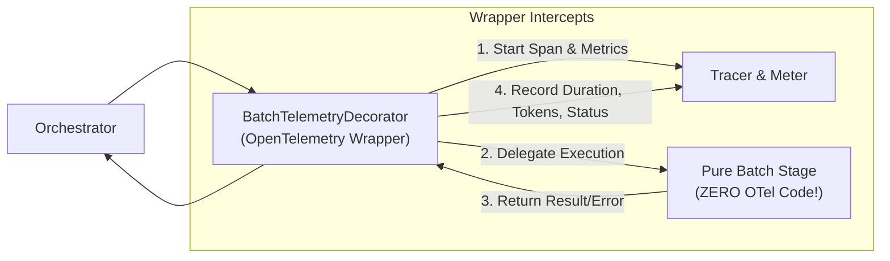
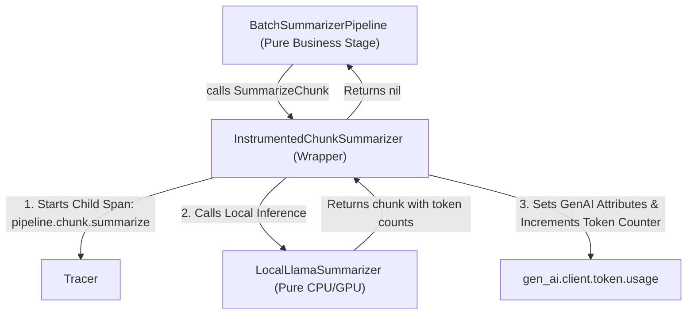

# The OpenTelemetry Wrapper in the Batch Pipeline

In software architecture, a **wrapper** (also known as the **Decorator Pattern**) is a structural design pattern that lets you attach new behaviors (such as OpenTelemetry tracing and metrics) to objects without altering their original source code.

This document breaks down **how the OpenTelemetry wrappers work**, **how they are structured**, and **how they intercept execution** in the batch pipeline.

---

## 1. The Core Problem: Why Use a Wrapper?

Without a wrapper, observability code quickly pollutes business logic:

```go
// ❌ WITHOUT WRAPPER (Polluted Business Logic)
func (s *Summarizer) Run(ctx context.Context, params *FilterParams) error {
    ctx, span := tracer.Start(ctx, "pipeline.stage.summarizer.batch") // OTel leak!
    defer span.End()
    metricActive.Add(ctx, 1) // OTel leak!
    defer metricActive.Add(ctx, -1)

    // Actual business logic is drowned in telemetry code...
    for _, doc := range params.Docs {
        // ...
    }
}
```

With the **Wrapper Pattern**, the stage code contains **100% pure Go business logic** with **zero OpenTelemetry imports**. The wrapper wraps around the stage like a protective jacket:



---

## 2. The 3 Wrapper Layers in the Batch Pipeline

The batch pipeline uses wrappers at three distinct architectural boundaries:

| Wrapper Layer | Struct Name | Wrapped Interface | What It Measures |
| :--- | :--- | :--- | :--- |
| **1. Workflow Layer** | `BatchOrchestrator` (`internal/pipeline/batch/orchestrator.go`) | `[]pipeline.Pipeline` | Root workflow trace, stage milestones, total pipeline duration. |
| **2. Batch Stage Layer** | `BatchTelemetryDecorator` (`internal/pipeline/batch/decorator.go`) | `pipeline.Pipeline` (`internal/pipeline/types.go`) | Stage parent span, in-flight stages counter, document counts, stage latency. |
| **3. Chunk Engine Layer** | `InstrumentedChunkSummarizer` (`internal/pipeline/batch/engine_decorators.go`) | `ChunkSummarizer` (`internal/pipeline/batch/engines.go`) | Per-chunk child spans, GenAI token counts, per-chunk inference latency. |

---

## 3. Deep Dive: The Stage Wrapper (`BatchTelemetryDecorator`)

Located in `internal/pipeline/batch/decorator.go`.

### A. Structure Definition
The wrapper stores a reference to the **next** stage in the pipeline, the OpenTelemetry **Tracer**, and the registered **BatchMetrics**:

```go
type BatchTelemetryDecorator struct {
    next    pipeline.Pipeline // The pure business stage being wrapped
    tracer  trace.Tracer      // OpenTelemetry Tracer
    metrics *BatchMetrics     // Prometheus/OTel metric instruments
}

// Compile-time check: verifies decorator fulfills the exact Pipeline interface!
var _ pipeline.Pipeline = (*BatchTelemetryDecorator)(nil)
```

### B. The Factory Function
To wrap any pure stage, you simply pass it to `WrapBatchStage`:

```go
func WrapBatchStage(stage pipeline.Pipeline, metrics *BatchMetrics) pipeline.Pipeline {
    return &BatchTelemetryDecorator{
        next:    stage,
        tracer:  otel.Tracer("pipeline-batch-stage"),
        metrics: metrics,
    }
}
```

---

### C. Step-by-Step Execution Lifecycle Inside `Run()`

When `d.Run(ctx, params)` is invoked, the wrapper executes 6 distinct interception steps:

```go
func (d *BatchTelemetryDecorator) Run(ctx context.Context, params *request.FilterParams) error {
    stageStr := string(d.Stage())
    startTime := time.Now()

    // ─────────────────────────────────────────────────────────────
    // STEP 1: In-Flight Gauge / UpDownCounter
    // ─────────────────────────────────────────────────────────────
    // Increments active stages count; decrements automatically on exit
    if d.metrics != nil {
        d.metrics.StageActive.Add(ctx, 1, metric.WithAttributes(
            attribute.String("pipeline.stage", stageStr),
        ))
        defer d.metrics.StageActive.Add(ctx, -1, metric.WithAttributes(
            attribute.String("pipeline.stage", stageStr),
        ))
    }

    // ─────────────────────────────────────────────────────────────
    // STEP 2: Inspect Batch Context
    // ─────────────────────────────────────────────────────────────
    docs, _ := GetDocuments(params)
    docCount := len(docs)
    initialChunks := TotalChunks(docs)

    // ─────────────────────────────────────────────────────────────
    // STEP 3: Start Parent Batch Span
    // ─────────────────────────────────────────────────────────────
    // The returned 'ctx' contains this span, so any calls inside
    // d.next.Run (like model load or chunk inference) become child spans!
    ctx, span := d.tracer.Start(ctx, fmt.Sprintf("pipeline.stage.%s.batch", stageStr),
        trace.WithAttributes(
            attribute.String("pipeline.stage", stageStr),
            attribute.String("pipeline.name", d.Name()),
            attribute.String("pipeline.request_id", params.RequestID),
            attribute.String("pipeline.tenant_id", params.TenantID),
            attribute.Int("pipeline.batch.document_count", docCount),
            attribute.Int("pipeline.batch.initial_chunk_count", initialChunks),
        ),
    )
    defer span.End()

    // ─────────────────────────────────────────────────────────────
    // STEP 4: Delegate to Pure Business Logic
    // ─────────────────────────────────────────────────────────────
    err := d.next.Run(ctx, params)
    durationMs := float64(time.Since(startTime).Milliseconds())

    // ─────────────────────────────────────────────────────────────
    // STEP 5: Intercept Failure
    // ─────────────────────────────────────────────────────────────
    if err != nil {
        // Record failure onto span
        span.RecordError(err)
        span.SetStatus(codes.Error, err.Error())

        // Record failure metrics into Prometheus
        if d.metrics != nil {
            errAttrs := metric.WithAttributes(
                attribute.String("pipeline.stage", stageStr),
                attribute.String("status", "failed"),
                attribute.String("error.type", fmt.Sprintf("%T", err)),
            )
            d.metrics.StageRuns.Add(ctx, 1, errAttrs)
            d.metrics.StageDuration.Record(ctx, durationMs, errAttrs)
        }
        return err
    }

    // ─────────────────────────────────────────────────────────────
    // STEP 6: Intercept Success & Record Telemetry
    // ─────────────────────────────────────────────────────────────
    finalChunks := TotalChunks(docs)
    span.SetAttributes(
        attribute.Int("pipeline.batch.final_chunk_count", finalChunks),
    )
    span.SetStatus(codes.Ok, "stage completed successfully")

    if d.metrics != nil {
        successAttrs := metric.WithAttributes(
            attribute.String("pipeline.stage", stageStr),
            attribute.String("status", "success"),
        )
        d.metrics.StageRuns.Add(ctx, 1, successAttrs)
        d.metrics.StageDuration.Record(ctx, durationMs, successAttrs)
        d.metrics.ItemsProcessed.Add(ctx, int64(docCount), successAttrs)
    }

    return nil
}
```

---

## 4. Deep Dive: The Chunk Engine Wrapper (`InstrumentedChunkSummarizer`)

Located in `internal/pipeline/batch/engine_decorators.go`.

While `BatchTelemetryDecorator` handles the **batch as a whole**, the stage still needs to summarize individual chunks. To avoid putting OTel code inside the local LLM inference engine, we use an **engine wrapper**:



### How the Engine Wrapper Works in Code:
```go
func (s *InstrumentedChunkSummarizer) SummarizeChunk(ctx context.Context, chunk *ChunkItem) error {
    startTime := time.Now()

    // 1. Child span (automatically parented by pipeline.stage.summarizer.batch)
    ctx, span := s.tracer.Start(ctx, "pipeline.chunk.summarize",
        trace.WithAttributes(
            attribute.String("gen_ai.operation.name", "chat"),
            attribute.String("gen_ai.system", "llama.cpp"),
            attribute.String("gen_ai.request.model", s.next.ModelName()),
            attribute.String("pipeline.document_id", chunk.DocumentID),
            attribute.String("pipeline.chunk_id", chunk.ID),
            attribute.Int("pipeline.chunk_index", chunk.Index),
        ),
    )
    defer span.End()

    // 2. Delegate to pure llama.cpp inference engine
    err := s.next.SummarizeChunk(ctx, chunk)
    durationMs := float64(time.Since(startTime).Milliseconds())

    if err != nil {
        span.RecordError(err)
        span.SetStatus(codes.Error, err.Error())
        return err
    }

    // 3. Enrich span with official OpenTelemetry GenAI token counts
    span.SetAttributes(
        attribute.Int("gen_ai.usage.input_tokens", chunk.InputTokens),
        attribute.Int("gen_ai.usage.output_tokens", chunk.OutputTokens),
    )
    span.SetStatus(codes.Ok, "chunk summarized")

    // 4. Update Prometheus GenAI token metrics & latency histogram
    if s.metrics != nil {
        baseAttrs := []attribute.KeyValue{
            attribute.String("gen_ai.operation.name", "chat"),
            attribute.String("gen_ai.system", "llama.cpp"),
            attribute.String("gen_ai.request.model", s.next.ModelName()),
        }

        inAttrs := append(baseAttrs, attribute.String("gen_ai.token.type", "input"))
        outAttrs := append(baseAttrs, attribute.String("gen_ai.token.type", "output"))

        s.metrics.TokenUsage.Add(ctx, int64(chunk.InputTokens), metric.WithAttributes(inAttrs...))
        s.metrics.TokenUsage.Add(ctx, int64(chunk.OutputTokens), metric.WithAttributes(outAttrs...))
        s.metrics.ChunkDuration.Record(ctx, durationMs, metric.WithAttributes(baseAttrs...))
        s.metrics.ChunksProcessed.Add(ctx, 1, metric.WithAttributes(baseAttrs...))
    }

    return nil
}
```

---

## 5. How Everything Assembles in `main.go`

In `cmd/localai/main.go`, you can see how straightforward it is to compose these wrappers:

```go
// 1. Wrap pure chunk engines with GenAI telemetry wrappers
llamaSummarizer := batch.WrapSummarizer(
    batch.NewLocalLlamaSummarizer("llama-3-8b-instruct.gguf"),
    batchMetrics,
)

// 2. Instantiate pure batch stages (they receive the wrapped engine, but have no OTel code themselves!)
stageList := []pipeline.Pipeline{
    stages.NewBatchChunkingPipeline(35),
    stages.NewBatchSummarizerPipeline(modelMgr, "llama-3-8b.gguf", 4_500_000_000, llamaSummarizer),
    stages.NewBatchEmbeddingsPipeline(modelMgr, "bge-large.gguf", 1_300_000_000, bgeEmbedder),
}

// 3. Assemble Orchestrator: It automatically wraps every stage with BatchTelemetryDecorator!
orchestrator := batch.NewBatchOrchestrator("local-ai-staged-workflow", stageList, batchMetrics)
```

---

## 6. Key Benefits of This Architecture

1. **Zero OpenTelemetry Code in Domain**: If OpenTelemetry is replaced by another tool (or if you write simple unit tests), the stages `BatchChunkingPipeline` and `BatchSummarizerPipeline` never change.
2. **Standardization**: Every stage automatically records active runs, latency histograms, error codes, and batch document counts consistently.
3. **Automatic Span Hierarchy**: Because the wrapper passes the enriched `ctx` down to the pure stage, any child spans started inside (like `ai.model.load` or `pipeline.chunk.summarize`) are **automatically** organized as children under the stage span.
4. **Resilience**: The wrapper's `defer` statements guarantee that in-flight gauges and spans are always finalized, even if a panic or unexpected error occurs inside a stage.
