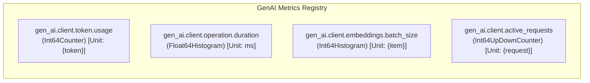

# Industry-Standard OpenTelemetry Instrumentation for Embedding Clients

This guide details how to instrument embedding clients (such as Google Gemma, OpenAI, or local embedding models) using the **official OpenTelemetry GenAI Semantic Conventions**.

---

## 🎯 Official OpenTelemetry GenAI Standards for Embeddings

OpenTelemetry defines specific conventions for Large Language Models and Embedding operations under the `gen_ai.*` namespace.

### 1. Span Specification
* **Span Name**: `embeddings {gen_ai.request.model}` (e.g. `embeddings google/embeddinggemma-300m`) or simply `embeddings`.
* **Span Kind**: [`trace.SpanKindClient`](file:///Users/sarthak/Documents/code/golang/OpenTelemeteryTutorial/internal/instrumented/instrumented.go#L64) (signaling an outbound inference call to a model engine or remote API).
* **Span Status**: Must be set to `codes.Ok` on success, or `codes.Error` with `span.RecordError(err)` on failure.

### 2. Standard Semantic Attributes

| Attribute Key | Type | Description | Example |
| :--- | :--- | :--- | :--- |
| `gen_ai.system` | `string` | The AI provider or engine name | `"google"`, `"openai"`, `"llama.cpp"` |
| `gen_ai.operation.name` | `string` | The GenAI operation performed | `"embeddings"` |
| `gen_ai.request.model` | `string` | The model requested for inference | `"google/embeddinggemma-300m"` |
| `gen_ai.usage.input_tokens` | `int` | Count of prompt/input tokens consumed | `42` |
| `gen_ai.response.dimensions`| `int` | Dimensionality of the resulting vector | `768` |
| `gen_ai.request.batch_size` | `int` | Number of text inputs in this request | `1` (or `len(texts)` for batches) |
| `gen_ai.embedding.normalized` | `bool` | Whether vectors are pre-normalized | `true` or `false` |
| `gen_ai.embedding.task_type` | `string` | Task purpose (Gemma/E5 convention) | `"retrieval_query"`, `"retrieval_document"` |
| `error.type` | `string` | Go error type if the call failed | `"*net.OpError"`, `"context.DeadlineExceeded"` |

---

## 📊 Standard GenAI Metrics for Embeddings

According to OpenTelemetry GenAI metrics guidelines, embedding clients should record 4 core instruments:



| Metric Name | Instrument | Unit | Description | Key Dimensions (Labels) |
| :--- | :--- | :--- | :--- | :--- |
| **`gen_ai.client.token.usage`** | `Int64Counter` | `{token}` | Number of tokens consumed by the embedding model | `gen_ai.operation.name="embeddings"`, `gen_ai.system`, `gen_ai.request.model`, `gen_ai.token.type="input"` |
| **`gen_ai.client.operation.duration`** | `Float64Histogram` | `ms` | End-to-end latency of the embedding API call | `gen_ai.operation.name="embeddings"`, `gen_ai.system`, `gen_ai.request.model`, `error.type` (if failed) |
| **`gen_ai.client.embeddings.batch_size`**| `Int64Histogram` | `{item}` | Distribution of text count per batch call | `gen_ai.request.model`, `gen_ai.system` |
| **`gen_ai.client.active_requests`** | `Int64UpDownCounter` | `{request}`| Active in-flight embedding requests | `gen_ai.operation.name="embeddings"`, `gen_ai.request.model` |

---

## 🔍 Code Walkthrough of `internal/instrumented/`

### 1. In-Flight Active Requests & Span Initialization
Before calling the underlying model, start the client span and increment active requests:

```go
func (gc *InstrumentedGoogleGemmaEmbeddingClient) GetEmbedding(ctx context.Context, text string) ([]float32, error) {
    model := gc.embedder.GetModel()
    dims := gc.embedder.GetDimensionality()
    startTime := time.Now()

    // 1. In-flight active request tracking
    if gc.metrics != nil {
        activeAttrs := metric.WithAttributes(
            attribute.String("gen_ai.operation.name", "embeddings"),
            attribute.String("gen_ai.system", gc.system),
            attribute.String("gen_ai.request.model", model),
        )
        gc.metrics.ActiveRequests.Add(ctx, 1, activeAttrs)
        defer gc.metrics.ActiveRequests.Add(ctx, -1, activeAttrs)
    }

    // 2. Start OpenTelemetry GenAI Client Span
    ctx, span := gc.tracer.Start(ctx, fmt.Sprintf("embeddings %s", model),
        trace.WithSpanKind(trace.SpanKindClient),
        trace.WithAttributes(
            attribute.String("gen_ai.system", gc.system),
            attribute.String("gen_ai.operation.name", "embeddings"),
            attribute.String("gen_ai.request.model", model),
            attribute.Int("gen_ai.request.batch_size", 1),
            attribute.Int("gen_ai.response.dimensions", dims),
            attribute.Bool("gen_ai.embedding.normalized", gc.embedder.IsNormalized()),
        ),
    )
    defer span.End()

    // 3. Call underlying embedding API
    respJSON200, err := gc.embedder.GetEmbedding(ctx, text)
    durationMs := float64(time.Since(startTime).Milliseconds())
```

### 2. Robust Error Handling
If an error occurs (network failure, rate limit, timeout):

```go
    if err != nil {
        span.RecordError(err)
        span.SetStatus(codes.Error, err.Error())
        span.SetAttributes(attribute.String("error.type", fmt.Sprintf("%T", err)))

        if gc.metrics != nil {
            errAttrs := metric.WithAttributes(
                attribute.String("gen_ai.operation.name", "embeddings"),
                attribute.String("gen_ai.system", gc.system),
                attribute.String("gen_ai.request.model", model),
                attribute.String("error.type", fmt.Sprintf("%T", err)),
            )
            gc.metrics.OperationDuration.Record(ctx, durationMs, errAttrs)
        }
        return nil, err
    }
```

### 3. Token Extraction & Metric Recording
Extract token usage from the API response (`respJSON200.Usage.PromptTokens`) and record both span attributes and Prometheus metrics:

```go
    // 5. Enrich Span with Token Usage & Actual Dimensions
    promptTokens := respJSON200.Usage.PromptTokens
    if promptTokens == 0 {
        promptTokens = respJSON200.Usage.TotalTokens
    }
    actualDims := len(respJSON200.Data[0].Embedding)

    span.SetAttributes(
        attribute.Int("gen_ai.usage.input_tokens", promptTokens),
        attribute.Int("gen_ai.response.dimensions", actualDims),
    )
    span.SetStatus(codes.Ok, "embedding generated successfully")

    // 6. Record Industry Standard Prometheus Metrics
    if gc.metrics != nil {
        baseAttrs := []attribute.KeyValue{
            attribute.String("gen_ai.operation.name", "embeddings"),
            attribute.String("gen_ai.system", gc.system),
            attribute.String("gen_ai.request.model", model),
        }

        // Token usage counter with token.type="input"
        tokenAttrs := append(baseAttrs, attribute.String("gen_ai.token.type", "input"))
        gc.metrics.TokenUsage.Add(ctx, int64(promptTokens), metric.WithAttributes(tokenAttrs...))

        // Latency histogram
        gc.metrics.OperationDuration.Record(ctx, durationMs, metric.WithAttributes(baseAttrs...))

        // Batch size distribution
        gc.metrics.BatchSize.Record(ctx, 1, metric.WithAttributes(baseAttrs...))
    }

    return respJSON200.Data[0].Embedding, nil
```

---

## 🌳 Resulting Trace Tree in Jaeger

When invoking higher-level helpers like `GetQueryEmbedding` or `GetDocumentEmbeddings`, a nested trace hierarchy is produced:

```
[Span] embedding.query: retrieval_query
  │   Attributes: gen_ai.embedding.task_type="retrieval_query"
  │
  └── [Child Span] embeddings google/embeddinggemma-300m (SpanKind: Client)
        ├── Attributes:
        │     gen_ai.system = "google"
        │     gen_ai.operation.name = "embeddings"
        │     gen_ai.request.model = "google/embeddinggemma-300m"
        │     gen_ai.usage.input_tokens = 14
        │     gen_ai.response.dimensions = 768
        │     gen_ai.request.batch_size = 1
        └── Status: Ok
```

---

## 🧪 Testing Your Implementation

Run the test suite to verify tracing and metrics collection:

```bash
go test -v ./internal/instrumented/...
```
