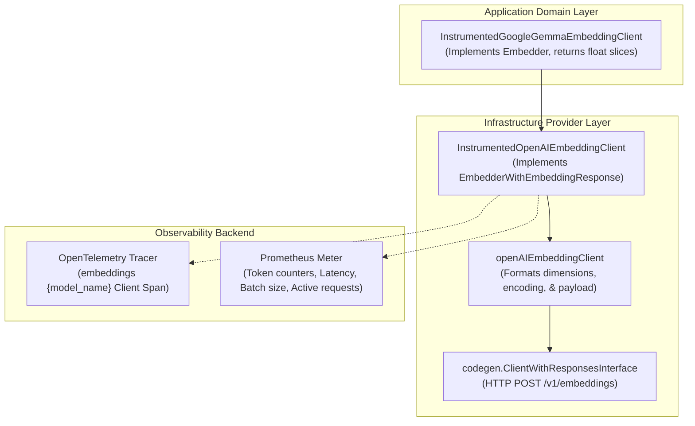

# Industry-Standard OpenTelemetry Instrumentation for OpenAIEmbeddingClient

This guide explains how [`InstrumentedOpenAIEmbeddingClient`](file:///Users/sarthak/Documents/code/golang/OpenTelemeteryTutorial/internal/instrumented/instrumented_openai_embedding.go#L20-L30) instruments the low-level OpenAI-compatible vector embedding provider ([`embedding.go`](file:///Users/sarthak/Documents/code/golang/OpenTelemeteryTutorial/internal/instrumented/embedding.go)) using the official **OpenTelemetry GenAI Semantic Conventions**.

---

## 🎯 Architecture Overview

The vector embedding subsystem mirrors our summarization design, organizing components into an application domain layer and an infrastructure provider layer:



### Key Components

1. **`openAIEmbeddingClient` ([`embedding.go`](file:///Users/sarthak/Documents/code/golang/OpenTelemeteryTutorial/internal/instrumented/embedding.go#L10-L16))**:
   - Manages request construction (`codegen.EmbeddingRequest_Input`, `codegen.EmbeddingRequest_Model`, `Dimensions`, `EncodingFormat: Float`).
   - Invokes `ClientWithResponsesInterface.CreateEmbeddingWithResponse(...)` against local or remote inference engines (`llama-server`, Ollama, LocalAI, OpenAI).
2. **`InstrumentedOpenAIEmbeddingClient` ([`instrumented_openai_embedding.go`](file:///Users/sarthak/Documents/code/golang/OpenTelemeteryTutorial/internal/instrumented/instrumented_openai_embedding.go#L20-L30))**:
   - Implements [`EmbedderWithEmbeddingResponse`](file:///Users/sarthak/Documents/code/golang/OpenTelemeteryTutorial/internal/instrumented/types.go#L64-L73).
   - Wraps single (`GetEmbedding`), batch (`GetEmbeddings`), query (`GetQueryEmbedding`), and document (`GetDocumentEmbedding`, `GetDocumentEmbeddings`) methods with OpenTelemetry traces and Prometheus metrics.

---

## 🔍 OpenTelemetry GenAI Semantic Conventions

### 1. Client Span Specification
- **Span Name**: `embeddings {model_name}` (e.g. `embeddings google/embeddinggemma-300m`).
- **Span Kind**: [`trace.SpanKindClient`](file:///Users/sarthak/Documents/code/golang/OpenTelemeteryTutorial/internal/instrumented/instrumented_openai_embedding.go#L155).
- **Standard Attributes**:

| Attribute Key | Type | Description | Example |
|---|---|---|---|
| `gen_ai.system` | `string` | Inference provider / architecture | `"openai"`, `"google"` |
| `gen_ai.operation.name` | `string` | Operation type | `"embeddings"` |
| `gen_ai.request.model` | `string` | Target model identifier | `"google/embeddinggemma-300m"` |
| `gen_ai.request.batch_size` | `int` | Number of input texts in request | `1` or `len(texts)` |
| `gen_ai.response.dimensions`| `int` | Vector dimensionality | `768` |
| `gen_ai.embedding.normalized`| `bool` | Whether vectors are pre-normalized | `false` |
| `gen_ai.embedding.task_type`| `string` | Task purpose (Gemma/E5 convention) | `"retrieval_query"` |
| `gen_ai.usage.input_tokens` | `int` | Number of input tokens consumed | `42` |
| `gen_ai.response.item_count`| `int` | Number of returned vector objects | `1` |
| `error.type` | `string` | Error classification on failure | `"*url.Error"` |

---

## 📊 Standard GenAI Metrics

All metric instruments are registered under meter `gen_ai.client.embeddings`:

| Metric Name | Instrument | Unit | Description | Key Labels |
|---|---|---|---|---|
| **`gen_ai.client.token.usage`** | `Int64Counter` | `{token}` | Number of input tokens consumed by the embedding model | `gen_ai.operation.name="embeddings"`, `gen_ai.system`, `gen_ai.request.model`, `gen_ai.token.type="input"` |
| **`gen_ai.client.operation.duration`** | `Float64Histogram` | `ms` | End-to-end latency of the embedding request | `gen_ai.operation.name="embeddings"`, `gen_ai.system`, `gen_ai.request.model`, `error.type` (if failed) |
| **`gen_ai.client.embeddings.batch_size`**| `Int64Histogram` | `{item}` | Distribution of text count per batch embedding call | `gen_ai.operation.name="embeddings"`, `gen_ai.system`, `gen_ai.request.model` |
| **`gen_ai.client.active_requests`** | `Int64UpDownCounter` | `{request}` | Real-time concurrent in-flight embedding requests | `gen_ai.operation.name="embeddings"`, `gen_ai.system`, `gen_ai.request.model` |

---

## 🚀 Usage Example

```go
package main

import (
    "context"
    "fmt"
    "log"

    "github.com/sarthak/opentelemetry-tutorial/internal/instrumented"
    "go.opentelemetry.io/otel"
)

func main() {
    ctx := context.Background()

    // 1. Initialize GenAI metrics instruments
    metrics, err := instrumented.NewEmbeddingMetrics(otel.Meter("my-embeddings-app"))
    if err != nil {
        log.Fatalf("failed to init metrics: %v", err)
    }

    // 2. Create the instrumented low-level OpenAI embedding client
    client, err := instrumented.NewInstrumentedOpenAIEmbeddingClient(
        ctx,
        "google/embeddinggemma-300m",
        768,
        false,
        metrics,
    )
    if err != nil {
        log.Fatalf("failed to init client: %v", err)
    }

    // 3. Generate embeddings with automatic traces and metrics
    resp, err := client.GetEmbedding(ctx, "Retrieval Augmented Generation with OpenTelemetry.")
    if err != nil {
        log.Fatalf("embedding error: %v", err)
    }

    fmt.Printf("Generated %d dimensions vector, consumed %d tokens\n",
        len(resp.Data[0].Embedding), resp.Usage.PromptTokens)
}
```
