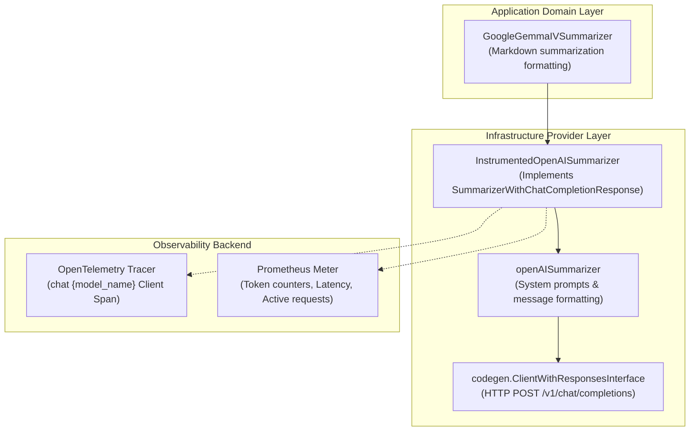

# Industry-Standard OpenTelemetry Instrumentation for OpenAISummarizer

This guide explains how [`InstrumentedOpenAISummarizer`](file:///Users/sarthak/Documents/code/golang/OpenTelemeteryTutorial/internal/instrumented/instrumented_openai.go#L36-L45) instruments the low-level OpenAI-compatible chat completion provider ([`summary.go`](file:///Users/sarthak/Documents/code/golang/OpenTelemeteryTutorial/internal/instrumented/summary.go)) using the official **OpenTelemetry GenAI Semantic Conventions**.

---

## 🎯 Architecture Overview

The summarization subsystem follows a clean two-tier design:



### Key Components

1. **`openAISummarizer` ([`summary.go`](file:///Users/sarthak/Documents/code/golang/OpenTelemeteryTutorial/internal/instrumented/summary.go#L19-L38))**:
   - Manages prompt engineering templates (`ShortSummarySystemPrompt`, `SummarySystemPrompt`, `MergeSummarySystemPrompt`, `MergeLongSummarySystemPrompt`).
   - Translates domain calls into structured `codegen.ChatCompletionRequestMessage` slices.
2. **`InstrumentedOpenAISummarizer` ([`instrumented_openai.go`](file:///Users/sarthak/Documents/code/golang/OpenTelemeteryTutorial/internal/instrumented/instrumented_openai.go#L36-L45))**:
   - Implements [`SummarizerWithChatCompletionResponse`](file:///Users/sarthak/Documents/code/golang/OpenTelemeteryTutorial/internal/instrumented/summary.go#L12-L21).
   - Wraps the core inference method [`Summary(ctx, msgs)`](file:///Users/sarthak/Documents/code/golang/OpenTelemeteryTutorial/internal/instrumented/instrumented_openai.go#L137) with standard GenAI traces and metrics.
   - Propagates contextual execution metadata (`gen_ai.summary.type`, `gen_ai.request.prompt_version`, `gen_ai.request.document_count`) from high-level methods to the client span.

---

## 🔍 OpenTelemetry GenAI Semantic Conventions

### 1. Client Span Specification
- **Span Name**: `chat {model_name}` (e.g., `chat google/gemma-4-E4B-it-qat-q4_0-gguf`).
- **Span Kind**: [`trace.SpanKindClient`](file:///Users/sarthak/Documents/code/golang/OpenTelemeteryTutorial/internal/instrumented/instrumented_openai.go#L170).
- **Standard Attributes**:

| Attribute Key | Type | Description | Example |
|---|---|---|---|
| `gen_ai.system` | `string` | Inference provider / architecture | `"openai"`, `"google"`, `"llama.cpp"` |
| `gen_ai.operation.name` | `string` | Operation type | `"chat"` |
| `gen_ai.request.model` | `string` | Target model identifier | `"google/gemma-4-E4B-it-qat-q4_0-gguf"` |
| `gen_ai.request.temperature` | `float64` | Configured temperature | `0.2` |
| `gen_ai.request.top_p` | `float64` | Configured nucleus sampling | `0.9` |
| `gen_ai.request.messages_count`| `int` | Number of messages in request | `2` |
| `gen_ai.summary.type` | `string` | Summary classification | `"short"`, `"long"`, `"merged"` |
| `gen_ai.request.document_count`| `int` | Count of merged input documents | `3` |
| `gen_ai.response.id` | `string` | Unique completion ID | `"chatcmpl-mock-..."` |
| `gen_ai.response.model` | `string` | Model that fulfilled generation | `"google/gemma-4-E4B-it-qat-q4_0-gguf"` |
| `gen_ai.response.finish_reasons`| `[]string`| Finish reasons array | `["stop"]` |
| `gen_ai.usage.input_tokens` | `int` | Context tokens consumed | `120` |
| `gen_ai.usage.output_tokens`| `int` | Completion tokens generated | `35` |
| `gen_ai.usage.total_tokens` | `int` | Total tokens consumed | `155` |
| `error.type` | `string` | Go error type on failure | `"*url.Error"` |

---

## 📊 Standard GenAI Metrics

All metric instruments are registered under meter `gen_ai.client.summarization`:

| Metric Name | Instrument | Unit | Description | Key Labels |
|---|---|---|---|---|
| **`gen_ai.client.token.usage`** | `Int64Counter` | `{token}` | Cumulative tokens consumed or generated | `gen_ai.operation.name="chat"`, `gen_ai.system`, `gen_ai.request.model`, `gen_ai.token.type` (`"input"` vs `"output"`) |
| **`gen_ai.client.operation.duration`** | `Float64Histogram` | `ms` | End-to-end latency of the inference request | `gen_ai.operation.name="chat"`, `gen_ai.system`, `gen_ai.request.model`, `gen_ai.summary.type`, `error.type` (if failed) |
| **`gen_ai.client.summary.document_count`** | `Int64Histogram` | `{document}`| Distribution of documents in merged summaries | `gen_ai.operation.name="chat"`, `gen_ai.system`, `gen_ai.request.model` |
| **`gen_ai.client.active_requests`** | `Int64UpDownCounter` | `{request}` | Real-time concurrent in-flight requests | `gen_ai.operation.name="chat"`, `gen_ai.system`, `gen_ai.request.model` |

---

## 🚀 Usage Example

```go
package main

import (
    "context"
    "fmt"
    "log"

    "github.com/sarthak/opentelemetry-tutorial/internal/instrumented"
    "go.opentelemetry.io/otel"
)

func main() {
    ctx := context.Background()

    // 1. Initialize GenAI metrics instruments
    metrics, err := instrumented.NewSummaryMetrics(otel.Meter("my-summarizer-app"))
    if err != nil {
        log.Fatalf("failed to init metrics: %v", err)
    }

    // 2. Create the instrumented low-level OpenAI summarizer
    openAISummarizer, err := instrumented.NewInstrumentedOpenAISummarizer(
        ctx,
        "google/gemma-4-E4B-it-qat-q4_0-gguf",
        metrics,
    )
    if err != nil {
        log.Fatalf("failed to init summarizer: %v", err)
    }

    // 3. Optional: Configure provider system or hyperparameters
    openAISummarizer.SetSystem("google")
    openAISummarizer.SetHyperparameters(0.1, 0.95)

    // 4. Generate summaries with automatic traces and metrics
    resp, err := openAISummarizer.GetSummary(ctx, "OpenTelemetry GenAI standardization for Go.")
    if err != nil {
        log.Fatalf("summary error: %v", err)
    }

    content, _ := resp.Choices[0].Message.Content.AsChatCompletionResponseMessageContent0()
    fmt.Printf("Summary: %s\n", content)
}
```
