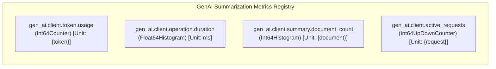
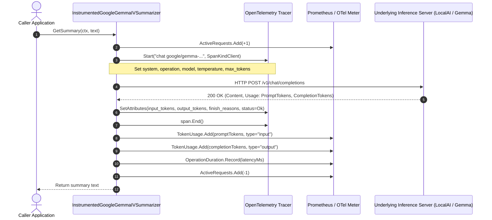

# Industry-Standard OpenTelemetry Instrumentation for LLM Summarization Clients

This guide details how to instrument Large Language Model (LLM) text generation and summarization clients (such as Google Gemma, OpenAI, or local GGUF/llama.cpp inference servers) using the **official OpenTelemetry GenAI Semantic Conventions**.

---

## 🎯 Official OpenTelemetry GenAI Standards for Summarization & Chat

OpenTelemetry models LLM inference and chat completion operations under the `gen_ai.*` namespace.

### 1. Span Specification
* **Span Name Format**: `{gen_ai.operation.name} {gen_ai.request.model}` (e.g. `chat google/gemma-4-E4B-it-qat-q4_0-gguf` or `chat gemma`).
* **Span Kind**: [`trace.SpanKindClient`](file:///Users/sarthak/Documents/code/golang/OpenTelemeteryTutorial/internal/instrumented/instrumented_summary.go#L202) (signaling an outbound network call to a model inference engine or remote API).
* **Span Status**: Must be set to `codes.Ok` on successful response generation, or `codes.Error` with `span.RecordError(err)` on failure.

### 2. Standard Semantic Attributes

| Attribute Key | Type | Description | Example |
| :--- | :--- | :--- | :--- |
| `gen_ai.system` | `string` | The AI provider or model family | `"google"`, `"openai"`, `"llama.cpp"` |
| `gen_ai.operation.name` | `string` | The GenAI operation performed | `"chat"`, `"text_completion"` |
| `gen_ai.request.model` | `string` | The target model identifier | `"google/gemma-4-E4B-it-qat-q4_0-gguf"` |
| `gen_ai.request.temperature` | `float64` | Sampling temperature | `0.1` |
| `gen_ai.request.top_p` | `float64` | Nucleus sampling cutoff | `1.0` |
| `gen_ai.request.max_tokens` | `int` | Maximum allowed completion tokens | `1024` |
| `gen_ai.summary.type` | `string` | Task differentiation attribute | `"short"`, `"long"`, `"long_v2"`, `"merged"` |
| `gen_ai.request.prompt_version` | `int` | Version identifier of the prompt template | `1`, `2` |
| `gen_ai.request.document_count` | `int` | Number of documents merged in multi-doc summarization | `3` |
| `gen_ai.response.id` | `string` | Unique completion ID returned by provider | `"chatcmpl-8abc9"` |
| `gen_ai.response.model` | `string` | Actual model that fulfilled the generation | `"gemma-4-E4B-it-qat-q4_0-gguf"` |
| `gen_ai.response.finish_reasons` | `[]string`| Why generation stopped | `["stop"]`, `["length"]` |
| `gen_ai.usage.input_tokens` | `int` | Number of prompt/context tokens | `142` |
| `gen_ai.usage.output_tokens`| `int` | Number of completion/generated tokens | `38` |
| `gen_ai.usage.total_tokens` | `int` | Total tokens consumed | `180` |
| `error.type` | `string` | Error classification on failure | `"*url.Error"`, `"context.DeadlineExceeded"` |

> [!IMPORTANT]
> **Privacy by Default**: Prompt text and generated summaries are **excluded from span attributes** by default to prevent leaking PII, secrets, or confidential user data into tracing backends (Jaeger, Datadog, Honeycomb). If message payloads are required for debugging in non-production environments, attach them as structured Span Events (`gen_ai.content.prompt` and `gen_ai.content.completion`).

---

## 📊 Standard GenAI Metrics for Summarization

In accordance with OpenTelemetry GenAI guidelines, summarization clients record 4 core metric instruments:



| Metric Name | Instrument | Unit | Description | Key Dimensions (Labels) |
| :--- | :--- | :--- | :--- | :--- |
| **`gen_ai.client.token.usage`** | `Int64Counter` | `{token}` | Cumulative tokens consumed or generated | `gen_ai.operation.name="chat"`, `gen_ai.system`, `gen_ai.request.model`, `gen_ai.token.type` (`"input"` vs `"output"`) |
| **`gen_ai.client.operation.duration`** | `Float64Histogram` | `ms` | End-to-end latency of the inference request | `gen_ai.operation.name="chat"`, `gen_ai.system`, `gen_ai.request.model`, `gen_ai.summary.type`, `error.type` (if failed) |
| **`gen_ai.client.summary.document_count`** | `Int64Histogram` | `{document}`| Distribution of documents in merged summaries | `gen_ai.operation.name="chat"`, `gen_ai.system`, `gen_ai.request.model` |
| **`gen_ai.client.active_requests`** | `Int64UpDownCounter` | `{request}` | Real-time concurrent in-flight requests | `gen_ai.operation.name="chat"`, `gen_ai.system`, `gen_ai.request.model` |

---

## 🏗️ Architecture & Control Flow

The instrumented client acts as a non-intrusive decorator implementing the [`Summarizer`](file:///Users/sarthak/Documents/code/golang/OpenTelemeteryTutorial/internal/instrumented/types.go#L46-L53) interface:



---

## 💻 Code Walkthrough of `internal/instrumented/`

### 1. [`instrumented_summary.go`](file:///Users/sarthak/Documents/code/golang/OpenTelemeteryTutorial/internal/instrumented/instrumented_summary.go)
Contains the [`InstrumentedGoogleGemmaIVSummarizer`](file:///Users/sarthak/Documents/code/golang/OpenTelemeteryTutorial/internal/instrumented/instrumented_summary.go#L96-L105) wrapper:
- Intercepts all summarization methods:
  - `GetSummary(ctx, text)`: Concise short summary (`gen_ai.summary.type="short"`, batch=1).
  - `GetLongSummary(ctx, text)`: Comprehensive detailed summary (`gen_ai.summary.type="long"`, batch=1).
  - `GetLongSummaryWithPromptVersion(ctx, text, version)`: Versioned prompt summary (`gen_ai.summary.type="long_v{N}"`, `gen_ai.request.prompt_version=version`).
  - `GetMergedSummary(ctx, texts)`: Multi-document consensus summary (`gen_ai.summary.type="merged"`, `gen_ai.request.document_count=len(texts)`).
  - `GetMergedLongSummary(ctx, texts)`: Multi-document in-depth summary (`gen_ai.summary.type="merged_long"`, `gen_ai.request.document_count=len(texts)`).
- Wraps the lifecycle in a single helper [`executeChatCall`](file:///Users/sarthak/Documents/code/golang/OpenTelemeteryTutorial/internal/instrumented/instrumented_summary.go#L168) that guarantees proper span closure, error logging, and gauge decrementing even during panics or timeouts.

### 2. [`metrics.go`](file:///Users/sarthak/Documents/code/golang/OpenTelemeteryTutorial/internal/instrumented/metrics.go)
Contains [`SummaryMetrics`](file:///Users/sarthak/Documents/code/golang/OpenTelemeteryTutorial/internal/instrumented/metrics.go#L80-L93) and constructor [`NewSummaryMetrics`](file:///Users/sarthak/Documents/code/golang/OpenTelemeteryTutorial/internal/instrumented/metrics.go#L95-L148). Registers the 4 standard GenAI instruments under meter name `gen_ai.client.summarization`.

### 3. [`types.go`](file:///Users/sarthak/Documents/code/golang/OpenTelemeteryTutorial/internal/instrumented/types.go)
Defines the client interfaces and models:
- [`Summarizer`](file:///Users/sarthak/Documents/code/golang/OpenTelemeteryTutorial/internal/instrumented/types.go#L46-L53): High-level contract returning clean strings.
- [`SummarizerWithChatCompletionResponse`](file:///Users/sarthak/Documents/code/golang/OpenTelemeteryTutorial/internal/instrumented/types.go#L55-L63): Low-level contract returning full OpenAI-compatible payloads with token usage.
- [`OpenAIChatCompletionResponse`](file:///Users/sarthak/Documents/code/golang/OpenTelemeteryTutorial/internal/instrumented/types.go#L65-L73): Struct matching OpenAI schema and OpenAPI generated client methods (`AsChatCompletionResponseMessageContent0`).
- [`NewOpenAISummarizer`](file:///Users/sarthak/Documents/code/golang/OpenTelemeteryTutorial/internal/instrumented/types.go#L207-L215): Fallback mock provider for offline testing.

---

## 📈 Recommended Prometheus (PromQL) Queries

### 1. Token Consumption Rate (Input vs. Output)
```promql
sum by (gen_ai_token_type, gen_ai_request_model) (
  rate(gen_ai_client_token_usage_total[5m])
)
```

### 2. P95 & P99 Summarization Latency
```promql
histogram_quantile(0.95, sum by (le, gen_ai_summary_type) (
  rate(gen_ai_client_operation_duration_milliseconds_bucket[5m])
))
```

### 3. Active Concurrent Summarization Requests
```promql
sum by (gen_ai_request_model) (
  gen_ai_client_active_requests
)
```

### 4. Error Rate by Model
```promql
sum by (error_type, gen_ai_request_model) (
  rate(gen_ai_client_operation_duration_milliseconds_count{error_type!=""}[5m])
) / sum by (gen_ai_request_model) (
  rate(gen_ai_client_operation_duration_milliseconds_count[5m])
)
```
