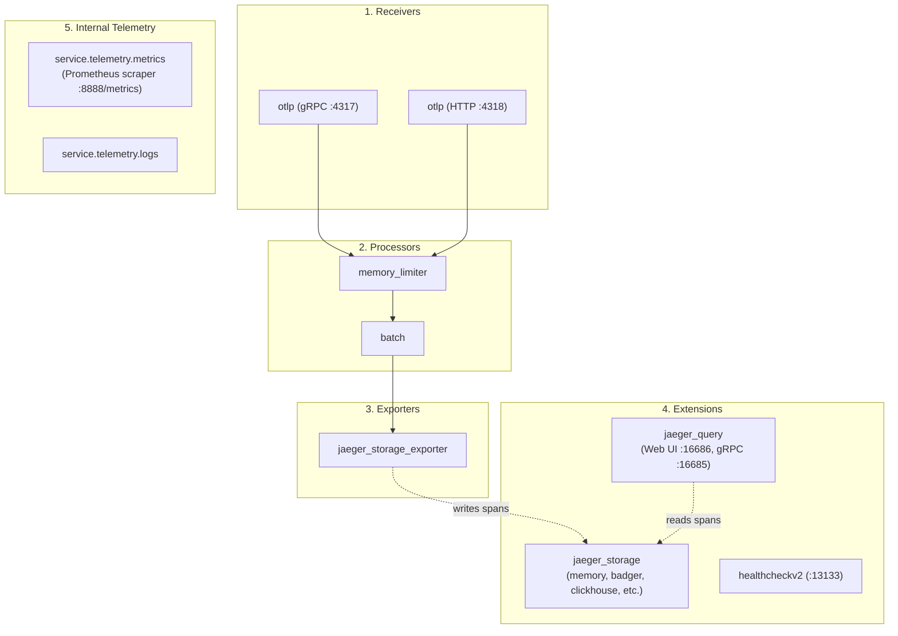

# Jaeger v2 (v2.23+) YAML Configuration Guide

Starting with version 2.0, **Jaeger has been completely re-architected on top of the OpenTelemetry Collector framework**. Instead of using legacy command-line flags and environment variables from v1, Jaeger v2 uses an **OpenTelemetry Collector-compatible YAML configuration file** passed via `--config`.

---

## 🏗️ Architectural Overview: How Jaeger v2 Works

Jaeger v2 structures its components into standard OpenTelemetry pipelines alongside specialized Jaeger extensions:



---

## 📄 Complete Sample Configuration File (`jaeger-v2-local.yaml`)

Here is the complete configuration file for a local standalone deployment. It is also available in the repository root as [`jaeger-v2-local.yaml`](file:///Users/sarthak/Documents/code/golang/OpenTelemeteryTutorial/jaeger-v2-local.yaml):

```yaml
# ==============================================================================
# Jaeger v2.23+ Local Deployment Configuration
# ==============================================================================

service:
  extensions:
    - jaeger_storage
    - jaeger_query
    - healthcheckv2

  pipelines:
    traces:
      receivers: [otlp]
      processors: [memory_limiter, batch]
      exporters: [jaeger_storage_exporter]

  # ----------------------------------------------------------------------------
  # 1. Internal Telemetry: Prometheus Metrics & Component Logging
  # ----------------------------------------------------------------------------
  telemetry:
    logs:
      level: info       # Options: debug, info, warn, error
      encoding: console # Options: console (human readable) or json (production)

    metrics:
      level: normal     # Options: none (disabled), basic, normal, detailed
      readers:
        # Pull-based Prometheus scraper endpoint (Jaeger's own internal metrics)
        - pull:
            exporter:
              prometheus:
                host: "0.0.0.0"
                port: 8888 # Scrape endpoint: http://localhost:8888/metrics

# ------------------------------------------------------------------------------
# 2. Extensions: Storage Backends, Query UI, and Health Checks
# ------------------------------------------------------------------------------
extensions:
  healthcheckv2:
    use_v2: true
    http:
      endpoint: "0.0.0.0:13133"

  # Defines storage backends (memory, badger, clickhouse, elasticsearch, etc.)
  jaeger_storage:
    backends:
      local_memory:
        memory:
          max_traces: 50000 # Retain last 50,000 traces in RAM

  # Exposes the Web UI and Query API
  jaeger_query:
    storage:
      traces: local_memory # References the backend defined in jaeger_storage
    http:
      endpoint: "0.0.0.0:16686" # Web UI URL: http://localhost:16686
    grpc:
      endpoint: "0.0.0.0:16685" # gRPC Query Service

# ------------------------------------------------------------------------------
# 3. Receivers: Ingestion endpoints for SDKs & OTel Collectors
# ------------------------------------------------------------------------------
receivers:
  otlp:
    protocols:
      grpc:
        endpoint: "0.0.0.0:4317" # Standard OTLP gRPC port
      http:
        endpoint: "0.0.0.0:4318" # Standard OTLP HTTP port

# ------------------------------------------------------------------------------
# 4. Processors: Performance & memory protection
# ------------------------------------------------------------------------------
processors:
  memory_limiter:
    check_interval: 1s
    limit_percentage: 75
    spike_limit_percentage: 20

  batch:
    timeout: 1s
    send_batch_size: 256

# ------------------------------------------------------------------------------
# 5. Exporters: Connects the trace pipeline to the storage backend
# ------------------------------------------------------------------------------
exporters:
  jaeger_storage_exporter:
    trace_storage: local_memory # References backend defined in jaeger_storage
```

---

## 📊 How to Enable / Disable Prometheus Metrics

Jaeger v2 emits **internal operational metrics** (e.g. `otelcol_receiver_accepted_spans`, `otelcol_processor_batch_batch_send_size`, memory consumption, and storage write latency) using the OpenTelemetry Collector's `service.telemetry.metrics` engine.

### A. How to Enable the Prometheus Metrics Endpoint
To expose Prometheus metrics on a dedicated port (e.g. `8888`):

```yaml
service:
  telemetry:
    metrics:
      level: normal # 'normal' or 'detailed' (includes fine-grained bucket breakdowns)
      readers:
        - pull:
            exporter:
              prometheus:
                host: "0.0.0.0"
                port: 8888 # Endpoint: http://localhost:8888/metrics
```

#### How to Scrape & Verify:
```bash
curl -s http://localhost:8888/metrics | head -n 25
```
You will see Prometheus-formatted metrics:
```text
# HELP otelcol_receiver_accepted_spans Number of spans successfully pushed into the pipeline.
# TYPE otelcol_receiver_accepted_spans counter
otelcol_receiver_accepted_spans{receiver="otlp",transport="grpc"} 142
```

---

### B. How to Disable Prometheus Metrics Completely
If you want to reduce CPU overhead or prevent exposing a metrics port in production or local environments:

```yaml
service:
  telemetry:
    metrics:
      level: none # Completely disables metric generation
      readers: [] # Disables the HTTP scrape listener
```

> **Why `level: none`?** Setting `level: none` stops the metric SDK from collecting internal counters, eliminating memory allocations and CPU overhead from meter evaluations.

---

## ⚙️ Other Commonly Used Configurations

### 1. Persistent Storage on Local Disk (Badger)
If you do not want an external database like Elasticsearch or ClickHouse, but want traces to **persist across restarts** instead of vanishing from RAM:

```yaml
extensions:
  jaeger_storage:
    backends:
      local_badger:
        badger:
          ephemeral: false
          directories:
            keys: ./bin/badger_data/keys
            values: ./bin/badger_data/values

  jaeger_query:
    storage:
      traces: local_badger

exporters:
  jaeger_storage_exporter:
    trace_storage: local_badger
```

---

### 2. Remote Production Storage (ClickHouse)
For production deployments using ClickHouse:

```yaml
extensions:
  jaeger_storage:
    backends:
      prod_clickhouse:
        clickhouse:
          addresses:
            - "localhost:9000"
          database: "jaeger"
          auth:
            basic:
              username: "default"
              password: "${env:CLICKHOUSE_PASSWORD:-secret}"
          create_schema: true
```

---

### 3. Avoiding Port Conflicts on macOS
On macOS, port `4317` might already be used by a standalone OpenTelemetry Collector. You can remap Jaeger's OTLP receiver to `4319`:

```yaml
receivers:
  otlp:
    protocols:
      grpc:
        endpoint: "0.0.0.0:4319" # Remapped from default 4317
      http:
        endpoint: "0.0.0.0:4320" # Remapped from default 4318

extensions:
  jaeger_query:
    http:
      endpoint: "0.0.0.0:16686" # Web UI remains accessible at :16686
```

---

### 4. Customizing the UI (`jaeger_query`)
You can inject custom external links (e.g. Kibana logs, Grafana dashboards) or modify the lookback window:

```yaml
extensions:
  jaeger_query:
    storage:
      traces: local_memory
    ui:
      config_file: ./monitoring/jaeger-ui-config.json
```

Sample `./monitoring/jaeger-ui-config.json`:
```json
{
  "search": {
    "maxLookback": { "label": "2 Days", "value": "2d" },
    "maxLimit": 1500
  },
  "menu": [
    {
      "label": "Prometheus Metrics",
      "url": "http://localhost:9090"
    }
  ]
}
```

---

### 5. Environment Variable Interpolation
Jaeger v2 natively supports OpenTelemetry environment variable substitution using `${env:VAR_NAME:-default}`:

```yaml
receivers:
  otlp:
    protocols:
      grpc:
        endpoint: "0.0.0.0:${env:JAEGER_OTLP_GRPC_PORT:-4317}"

extensions:
  jaeger_storage:
    backends:
      local_memory:
        memory:
          max_traces: ${env:JAEGER_MAX_TRACES:-50000}
```

---

## 🚀 How to Run Jaeger v2 with the YAML Configuration

### Option A: Using the Native Standalone Binary on macOS
```bash
# Pass configuration directly using --config
./bin/jaeger-all-in-one --config=jaeger-v2-local.yaml
```
*(Or simply run `make run-jaeger`, which automatically loads `jaeger-v2-local.yaml`)*.

---

### Option B: Using Official Docker Container
```bash
docker run --rm -d \
  --name jaeger \
  -p 16686:16686 \
  -p 4317:4317 \
  -p 4318:4318 \
  -p 8888:8888 \
  -v $(pwd)/jaeger-v2-local.yaml:/etc/jaeger/config.yaml \
  jaegertracing/jaeger:2.23.0 \
  --config=/etc/jaeger/config.yaml
```

---

## 📋 Jaeger v2 Port Reference

| Port | Protocol | Component | Purpose |
| :--- | :--- | :--- | :--- |
| **`16686`** | HTTP | `jaeger_query` | Web UI & HTTP Query API (`http://localhost:16686`) |
| **`16685`** | gRPC | `jaeger_query` | gRPC Query retrieval service |
| **`4317`** | gRPC | `receivers.otlp` | Inbound OTLP trace collection |
| **`4318`** | HTTP | `receivers.otlp` | Inbound OTLP HTTP trace collection |
| **`8888`** | HTTP | `service.telemetry.metrics` | Internal Prometheus scrape endpoint (`http://localhost:8888/metrics`) |
| **`13133`** | HTTP | `healthcheckv2` | Health check endpoint (`http://localhost:13133`) |
