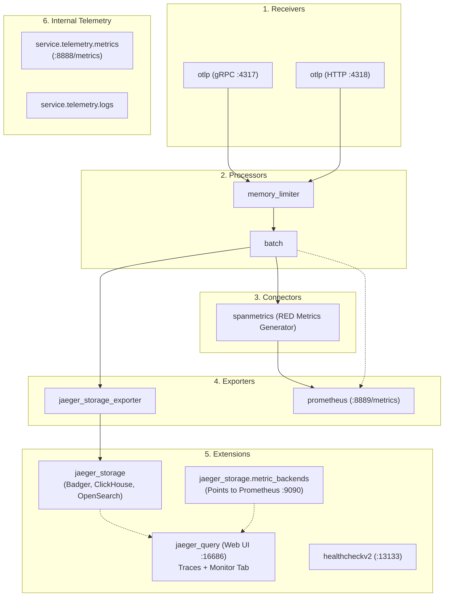

# Jaeger v2 (v2.23+) YAML Configuration Guide

Starting with version 2.0, **Jaeger has been completely re-architected on top of the OpenTelemetry Collector framework**. Instead of using legacy command-line flags and environment variables from v1, Jaeger v2 uses an **OpenTelemetry Collector-compatible YAML configuration file** passed via `--config`.

This guide covers:
1. **Persistent Storage** (Badger for embedded local disk, ClickHouse for high-throughput, and OpenSearch for enterprise).
2. **Metrics Collection** (Automatic RED SpanMetrics generation + OTLP application metrics ingestion).
3. **Prometheus Scraping Endpoints** (`:8888` for internal telemetry, `:8889` for pipeline/RED metrics, and Jaeger UI Monitor tab integration).
4. **Architectural Evaluation of Better Alternatives** (Grafana Tempo / LGTM Stack, SigNoz, Decoupled OTel Collector, VictoriaMetrics).

---

## 🏗️ Architectural Overview: How Jaeger v2 Works

Jaeger v2 structures its components into standard OpenTelemetry pipelines alongside specialized Jaeger extensions:



---

## 📄 Complete Verified Configuration (`jaeger-v2-local.yaml`)

This configuration is available in the repository root as [`jaeger-v2-local.yaml`](file:///Users/sarthak/Documents/code/golang/OpenTelemeteryTutorial/jaeger-v2-local.yaml):

```yaml
# ==============================================================================
# Jaeger v2 (v2.23+) Configuration
# Features:
# 1. Persistent Storage: Badger disk-backed storage (persists across restarts)
# 2. Metrics Collection: OTLP app metrics + SpanMetrics RED generator
# 3. Prometheus Scrape Endpoints:
#    - :8888/metrics (Jaeger internal operational telemetry)
#    - :8889/metrics (Generated SpanMetrics & ingested OTLP app metrics)
# 4. Jaeger UI Monitor Tab: Connected to Prometheus (:9090)
# ==============================================================================

service:
  extensions:
    - jaeger_storage
    - jaeger_query
    - healthcheckv2

  pipelines:
    # Traces pipeline: routes spans to persistent storage AND spanmetrics connector
    traces:
      receivers: [otlp]
      processors: [memory_limiter, batch]
      exporters: [jaeger_storage_exporter, spanmetrics]

    # Metrics pipeline: aggregates direct OTLP application metrics AND span-derived RED metrics
    metrics:
      receivers: [otlp, spanmetrics]
      processors: [memory_limiter, batch]
      exporters: [prometheus]

  # ----------------------------------------------------------------------------
  # Internal Telemetry: Exposes Jaeger's own operational metrics on :8888/metrics
  # ----------------------------------------------------------------------------
  telemetry:
    logs:
      level: info       # Options: debug, info, warn, error
      encoding: console # Options: console (human-readable) or json (production)

    metrics:
      level: normal     # Options: none, basic, normal, detailed
      readers:
        # Endpoint: http://localhost:8888/metrics (scraped by Prometheus job 'jaeger-internal')
        - pull:
            exporter:
              prometheus:
                host: "0.0.0.0"
                port: 8888

# ------------------------------------------------------------------------------
# Extensions: Storage backends, Query Web UI, and Health Checks
# ------------------------------------------------------------------------------
extensions:
  healthcheckv2:
    use_v2: true
    http:
      endpoint: "0.0.0.0:13133"

  # Storage backends: defines persistent trace storage and metrics backend for Query
  jaeger_storage:
    backends:
      # Persistent on-disk storage using Badger
      local_badger:
        badger:
          ephemeral: false
          directories:
            keys: ./bin/badger_data/keys
            values: ./bin/badger_data/values

    # Metric backend for the Jaeger Web UI "Monitor" Tab (RED metrics)
    metric_backends:
      prom_backend:
        prometheus:
          endpoint: "${env:PROMETHEUS_ENDPOINT:-http://localhost:9090}"
          normalize_calls: true
          normalize_duration: true

  # Jaeger Web UI & Query API
  jaeger_query:
    storage:
      traces: local_badger
      metrics: prom_backend # Enables the "Monitor" tab in Jaeger UI
    http:
      endpoint: "0.0.0.0:16686" # Web UI: http://localhost:16686
    grpc:
      endpoint: "0.0.0.0:16685" # gRPC Query Service

# ------------------------------------------------------------------------------
# Receivers: How Jaeger accepts traces and metrics from SDKs & Collectors
# ------------------------------------------------------------------------------
receivers:
  otlp:
    protocols:
      grpc:
        endpoint: "0.0.0.0:4317" # Standard OTLP gRPC port
      http:
        endpoint: "0.0.0.0:4318" # Standard OTLP HTTP port

# ------------------------------------------------------------------------------
# Processors: Memory protection and batching
# ------------------------------------------------------------------------------
processors:
  memory_limiter:
    check_interval: 1s
    limit_percentage: 75
    spike_limit_percentage: 20

  batch:
    timeout: 1s
    send_batch_size: 256

# ------------------------------------------------------------------------------
# Connectors: SpanMetrics automatically calculates RED metrics from traces
# ------------------------------------------------------------------------------
connectors:
  spanmetrics:
    histogram:
      explicit:
        buckets: [2ms, 6ms, 10ms, 25ms, 50ms, 100ms, 250ms, 500ms, 1s, 2.5s, 5s, 10s]
    dimensions:
      - name: http.status_code
      - name: rpc.grpc.status_code

# ------------------------------------------------------------------------------
# Exporters: Storage writing & Prometheus metric endpoint
# ------------------------------------------------------------------------------
exporters:
  # Writes traces to Badger disk storage
  jaeger_storage_exporter:
    trace_storage: local_badger

  # Scrape endpoint for Prometheus to collect SpanMetrics & App metrics (:8889/metrics)
  prometheus:
    endpoint: "0.0.0.0:8889"
```

---

## 💾 1. Persistent Storage Options

### A. Badger (Embedded Key-Value Store on Local Disk)
* **Use Case**: Single-node environments, local development, edge devices.
* **Why**: Zero external server to manage or pay for; data persists across restarts in `keys` and `values` directories.
```yaml
extensions:
  jaeger_storage:
    backends:
      local_badger:
        badger:
          ephemeral: false
          directories:
            keys: ./bin/badger_data/keys
            values: ./bin/badger_data/values
```

### B. ClickHouse (High-Throughput Columnar Database)
* **Use Case**: Scalable production tracing with high ingest rates and fast analytical queries.
* **Why**: Uses 5–10x less disk space than Elasticsearch due to columnar compression, zero JVM tuning.
```yaml
extensions:
  jaeger_storage:
    backends:
      prod_clickhouse:
        clickhouse:
          addresses: ["clickhouse:9000"]
          database: "jaeger"
          create_schema: true
```

### C. OpenSearch / Elasticsearch (Traditional Distributed Search)
* **Use Case**: Organizations with existing OpenSearch/ES infrastructure.
```yaml
extensions:
  jaeger_storage:
    backends:
      prod_opensearch:
        opensearch:
          endpoints: ["http://opensearch:9200"]
          index_prefix: "jaeger"
```

---

## 📈 2. Metrics Collection Strategy

Jaeger v2 handles **two separate metrics streams**:

1. **Derived RED Metrics (SpanMetrics)**:
   - The `spanmetrics` connector passively inspects all incoming trace spans.
   - Computes:
     - `calls_total` (Request Rate and Error Count partitioned by service, span name, and status code).
     - `duration_milliseconds` (Latency distribution histogram across predefined buckets).
2. **Application OTLP Metrics**:
   - Accepts metrics pushed by OpenTelemetry client SDKs (`otlpmetricgrpc` / `otlpmetrichttp`).
   - Prevents `Unimplemented unknown service MetricsService` errors.
   - Combines with SpanMetrics in the `metrics` pipeline to export to Prometheus.

---

## 🎯 3. Prometheus Scraping Configuration

Jaeger v2 exposes two scrape endpoints:

1. **`:8888/metrics`**: Jaeger's own operational metrics (`otelcol_receiver_accepted_spans`, `otelcol_processor_batch_batch_send_size`, memory usage).
2. **`:8889/metrics`**: The pipeline exporter delivering SpanMetrics (RED metrics) and application metrics.

### Prometheus Configuration ([`prometheus-local.yaml`](file:///Users/sarthak/Documents/code/golang/OpenTelemeteryTutorial/prometheus-local.yaml))
```yaml
scrape_configs:
  # Scrapes pipeline RED metrics and application metrics
  - job_name: "jaeger-pipeline"
    static_configs:
      - targets: ["localhost:8889"]

  # Scrapes Jaeger v2 internal health & operational metrics
  - job_name: "jaeger-internal"
    static_configs:
      - targets: ["localhost:8888"]
```

### Jaeger UI "Monitor" Tab Integration
By setting `metric_backends` in `jaeger_storage` and pointing `jaeger_query.storage.metrics` to it, the Jaeger UI queries Prometheus (`:9090`) to render the **Monitor Tab** with request rates, error rates, and p50/p95/p99 latency curves directly in the Jaeger UI.

---

## ⚖️ 4. Better Alternatives to Jaeger

While Jaeger v2 is an improvement over v1, several modern alternatives offer distinct advantages in cloud-native production:

### Alternative Comparison

| Architecture | Storage Engine | Metric Integration | Cost Profile | Best Fit |
|---|---|---|---|---|
| **Jaeger v2 + Prometheus** | Badger / ClickHouse / ES | External Prometheus (pull) | Medium | Teams wanting a dedicated trace viewer with standard OTel Collector config |
| **Grafana Tempo + Prometheus + Loki** | **Object Storage (S3 / GCS / MinIO)** | Native Remote-Write + Grafana UI | **Lowest** (no DB maintenance, cheap S3) | **Cloud-native teams already using Grafana** |
| **SigNoz** | **ClickHouse** | Native Unified (Traces + Metrics + Logs) | Low (Single data store) | **Teams wanting an all-in-one Datadog alternative without stitching tools** |
| **Decoupled OTel Collector + Prometheus + Jaeger** | Pluggable | Decoupled routing | Medium | **High-reliability enterprise architectures** |

### Why Grafana Tempo is Often Better:
1. **Object Storage Instead of Databases**: Stores traces in Amazon S3, Google Cloud Storage, or MinIO. You never have to manage Elasticsearch indices, sharding, or disk capacity.
2. **Cost Reduction**: Tracing storage costs drop by **75–90%** compared to Elasticsearch.
3. **Deep Telemetry Correlation**: In Grafana, clicking on a Prometheus metric spike or Loki log error instantly displays the exact correlated Tempo trace.

### Why SigNoz is Often Better:
1. **Single Pane of Glass**: Rather than running Jaeger (traces) + Prometheus (metrics) + Loki (logs) + Grafana (visualization), SigNoz bundles everything into one unified OpenTelemetry-native platform backed by ClickHouse.
2. **Zero-Configuration APM**: Generates service maps, error rates, and p99 latency alerts out of the box.
