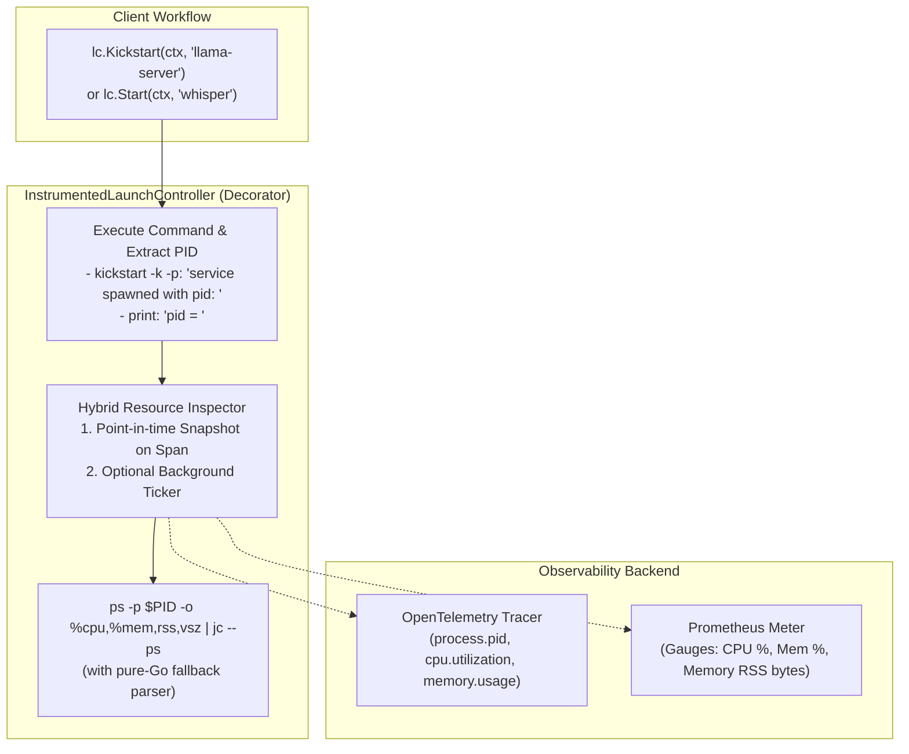

# Industry-Standard OpenTelemetry Instrumentation for macOS launchctl

This guide explains how [`InstrumentedLaunchController`](file:///Users/sarthak/Documents/code/golang/OpenTelemeteryTutorial/internal/instrumented/instrumented_launchctl.go#L53-L64) wraps the [`LaunchController`](file:///Users/sarthak/Documents/code/golang/OpenTelemeteryTutorial/internal/instrumented/launchctl.go#L11-L16) interface ([`launchctl.go`](file:///Users/sarthak/Documents/code/golang/OpenTelemeteryTutorial/internal/instrumented/launchctl.go)) using official **OpenTelemetry Process & Command Execution Semantic Conventions** and a **hybrid CPU & memory consumption monitoring strategy**.

---

## 🎯 Architecture Overview



---

## 🔍 PID Resolution Strategy

* **`Kickstart(ctx, service)`**:
  Executes `launchctl kickstart -k -p <target>`. On modern macOS, passing `-p` instructs `launchctl` to spawn the service and print the PID directly:
  ```text
  service spawned with pid: 12345
  ```
  The wrapper uses regex `service spawned with pid:\s*(\d+)` to instantly extract the PID without secondary lookups.
* **`Start(ctx, service)`**:
  Executes `launchctl start <target>` (kept separate as legacy syntax). If PID is not in output, the wrapper queries `launchctl print <target>` to discover `pid = <PID>`.
* **`Print(ctx, service)`**:
  Executes `launchctl print <target>` and extracts `pid = <PID>`.
* **`Stop(ctx, service)`**:
  Executes `launchctl stop <target>`, halts any active background resource monitor, and decrements the running service counter.

---

## ⚡ Hybrid CPU & Memory Monitoring (`jc --ps`)

Once the PID is known, the wrapper inspects the process:
```bash
ps -p $PID -o %cpu,%mem,rss,vsz | jc --ps
```
Output:
```json
[{"rss": 137092, "vsz": 35345680, "cpu_percent": 1.6, "mem_percent": 0.8}]
```

### 1. Point-in-time Snapshot
Automatically attached to the current `launchctl` execution span:
* `process.pid`: `12345`
* `process.cpu.utilization`: `1.6` (%)
* `process.memory.utilization`: `0.8` (%)
* `process.memory.usage`: `140382208` (RSS in bytes = `137092 * 1024`)

### 2. Continuous Background Polling (Optional)
By calling `lc.SetPollInterval(5 * time.Second)`, a lightweight background goroutine continuously samples `ps | jc` while the service runs, reporting real-time CPU and memory metrics to Prometheus until `Stop` is called.

---

## 📊 Prometheus Metric Instruments

Registered under meter `service.launchctl`:

| Metric Name | Instrument | Unit | Description | Key Labels |
|---|---|---|---|---|
| **`service.launchctl.operations.total`** | `Int64Counter` | `{operation}` | Total launchctl commands executed | `launchctl.action`, `service.name`, `status` (`"success"` / `"error"`), `error.type` |
| **`service.launchctl.operation.duration`** | `Float64Histogram` | `ms` | Latency distribution of command execution | `launchctl.action`, `service.name`, `status`, `error.type` |
| **`service.launchctl.active_operations`** | `Int64UpDownCounter` | `{operation}` | In-flight active launchctl commands | `launchctl.action`, `service.name` |
| **`service.launchctl.services_running`** | `Int64UpDownCounter` | `{service}` | Estimated count of running services | `service.name` |
| **`service.launchctl.process.cpu_utilization`** | `Float64Gauge` | `%` | Current CPU percentage of the running daemon | `service.name`, `process.pid` |
| **`service.launchctl.process.memory_bytes`** | `Int64Gauge` | `By` | Physical resident memory (RSS) in bytes | `service.name`, `process.pid` |
| **`service.launchctl.process.memory_utilization`**| `Float64Gauge` | `%` | Percentage of system physical RAM consumed | `service.name`, `process.pid` |

---

## 🚀 Usage Example

```go
package main

import (
    "context"
    "fmt"
    "log"
    "time"

    "github.com/sarthak/opentelemetry-tutorial/internal/instrumented"
    "go.opentelemetry.io/otel"
)

func main() {
    ctx := context.Background()

    // 1. Initialize metrics
    metrics, err := instrumented.NewLaunchctlMetrics(otel.Meter("my-app"))
    if err != nil {
        log.Fatalf("failed to init metrics: %v", err)
    }

    // 2. Initialize base executor (e.g. user GUI session "gui/501")
    baseExec := instrumented.NewExecLaunchController("gui/501")

    // 3. Wrap with OpenTelemetry instrumented decorator
    lc, err := instrumented.NewInstrumentedLaunchController(baseExec, metrics)
    if err != nil {
        log.Fatalf("failed to init controller: %v", err)
    }

    // 4. Activate hybrid continuous background monitoring (e.g. poll every 5s)
    lc.SetPollInterval(5 * time.Second)

    // 5. Kickstart service (-k -p) -> returns spawned PID and initiates monitoring
    out, err := lc.Kickstart(ctx, "llama-server")
    if err != nil {
        log.Fatalf("kickstart error: %v", err)
    }
    fmt.Println(out) // "service spawned with pid: 12345"

    // 6. Stop service when done -> terminates process and stops background poller
    defer func() {
        if _, err := lc.Stop(ctx, "llama-server"); err != nil {
            log.Printf("stop error: %v", err)
        }
    }()
}
```
