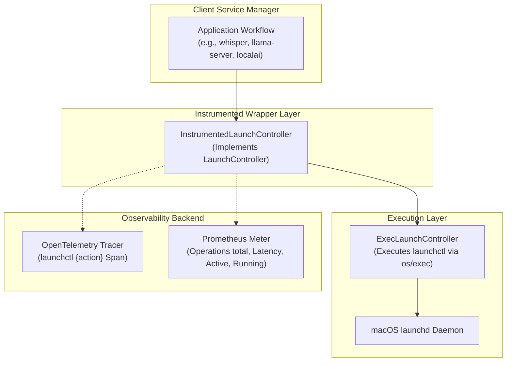

# Industry-Standard OpenTelemetry Instrumentation for macOS launchctl

This guide explains how [`InstrumentedLaunchController`](file:///Users/sarthak/Documents/code/golang/OpenTelemeteryTutorial/internal/instrumented/instrumented_launchctl.go#L19-L26) wraps the [`LaunchController`](file:///Users/sarthak/Documents/code/golang/OpenTelemeteryTutorial/internal/instrumented/launchctl.go#L11-L16) interface ([`launchctl.go`](file:///Users/sarthak/Documents/code/golang/OpenTelemeteryTutorial/internal/instrumented/launchctl.go)) using official **OpenTelemetry Process & Command Execution Semantic Conventions**.

---

## 🎯 Architecture Overview



---

## 🔍 OpenTelemetry Semantic Conventions for Process / Command Execution

### 1. Span Specification
- **Span Name**: `launchctl {action}` (e.g., `launchctl start`, `launchctl stop`, `launchctl kickstart`, `launchctl print`).
- **Span Kind**: [`trace.SpanKindInternal`](file:///Users/sarthak/Documents/code/golang/OpenTelemeteryTutorial/internal/instrumented/instrumented_launchctl.go#L114) (standard for CLI command invocations).
- **Standard Attributes**:

| Attribute Key | Type | Description | Example |
|---|---|---|---|
| `process.executable.name` | `string` | Binary name | `"launchctl"` |
| `process.command` | `string` | Invocation command | `"launchctl"` |
| `process.command_args` | `[]string` | Arguments vector | `["launchctl", "start", "whisper"]` |
| `launchctl.action` | `string` | Target subcommand | `"start"`, `"stop"`, `"kickstart"`, `"print"` |
| `service.name` | `string` | Name of the daemon/service | `"whisper"`, `"llama-server"` |
| `process.exit_code` | `int` | Process exit code | `0` (or non-zero on failure) |
| `process.output_length` | `int` | Output length in bytes | `42` |
| `error.type` | `string` | Error type on failure | `"*exec.ExitError"` |

---

## 📊 Standard Process & Service Metrics

Instruments are registered under meter `service.launchctl`:

| Metric Name | Instrument | Unit | Description | Key Dimensions (Labels) |
|---|---|---|---|---|
| **`service.launchctl.operations.total`** | `Int64Counter` | `{operation}` | Total launchctl commands executed | `launchctl.action`, `service.name`, `status` (`"success"` / `"error"`), `error.type` |
| **`service.launchctl.operation.duration`** | `Float64Histogram` | `ms` | Latency distribution of command execution | `launchctl.action`, `service.name`, `status`, `error.type` |
| **`service.launchctl.active_operations`** | `Int64UpDownCounter` | `{operation}` | In-flight active launchctl commands | `launchctl.action`, `service.name` |
| **`service.launchctl.services_running`** | `Int64UpDownCounter` | `{service}` | Estimated count of running services | `service.name` |

---

## 🚀 Usage Example

Matches your exact pattern:

```go
package main

import (
    "context"
    "fmt"
    "log"

    "github.com/sarthak/opentelemetry-tutorial/internal/instrumented"
    "go.opentelemetry.io/otel"
)

func main() {
    ctx := context.Background()

    // 1. Initialize metrics
    metrics, err := instrumented.NewLaunchctlMetrics(otel.Meter("my-app"))
    if err != nil {
        log.Fatalf("failed to init metrics: %v", err)
    }

    // 2. Initialize base executor (e.g. for user GUI session "gui/501" or system)
    baseExec := instrumented.NewExecLaunchController("gui/501")

    // 3. Wrap with OpenTelemetry instrumented decorator
    lc, err := instrumented.NewInstrumentedLaunchController(baseExec, metrics)
    if err != nil {
        log.Fatalf("failed to init instrumented launch controller: %v", err)
    }

    // 4. Start & Stop service with automatic traces and metrics
    out, err := lc.Start(ctx, "whisper")
    if err != nil {
        log.Fatalf("start error: %v", err)
    }
    defer func() {
        if _, err := lc.Stop(ctx, "whisper"); err != nil {
            log.Printf("stop error: %v", err)
        }
    }()

    fmt.Printf("Started service: %s\n", out)
}
```
