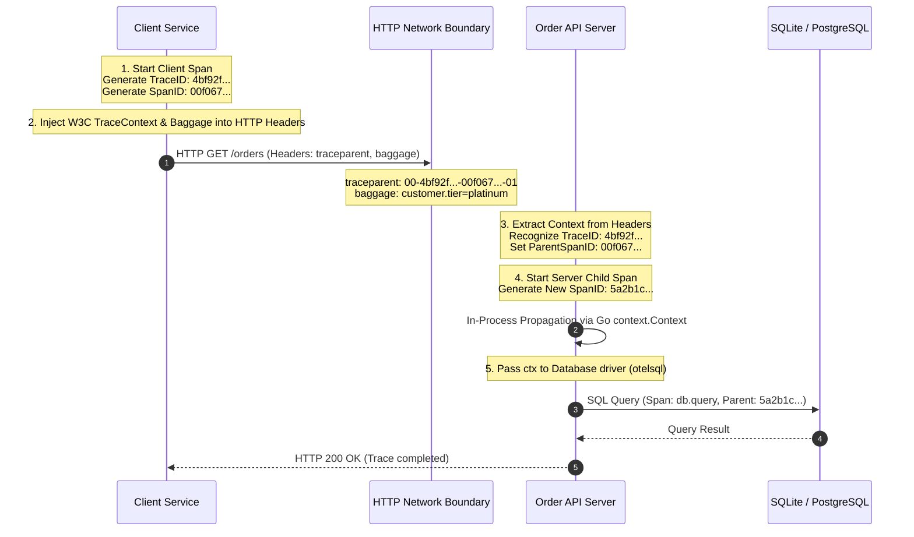
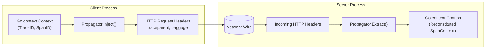
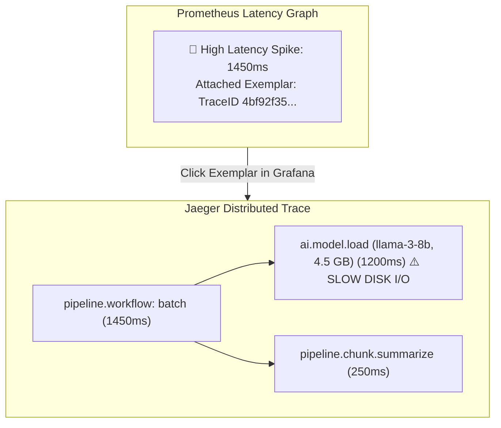
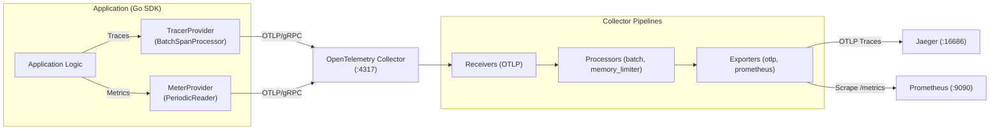

# OpenTelemetry Under the Hood: Tracing, Metrics, and Context Propagation

This comprehensive guide explains **how tracing and metrics work internally in OpenTelemetry**, how context propagates across function calls and network boundaries, and how the OpenTelemetry SDK connects distributed systems.

---

## 🧭 Executive Summary: The Two Worlds of Telemetry

In OpenTelemetry, there is a fundamental distinction between how **Traces** and **Metrics** behave:

| Capability | Traces (Distributed Context) | Metrics (Aggregated Timeseries) |
| :--- | :--- | :--- |
| **Primary Goal** | Follow a single request's complete path across threads, processes, and network hops. | Quantify system behavior in aggregate (rates, distributions, gauges) over time. |
| **Propagation** | **Propagated across the network** via W3C HTTP/gRPC headers (`traceparent`, `tracestate`, `baggage`). | **NOT propagated across network boundaries**. Each service aggregates its own metrics in memory. |
| **Data Structure** | Directed Acyclic Graph (DAG) of **Spans** linked by `TraceID` and `ParentSpanID`. | Timeseries data points `(Timestamp, MetricName, LabelSet, Value)`. |
| **The Bridge** | **Exemplars**: Metrics capture the active `TraceID`/`SpanID` at sample time, linking graphs directly to traces. |

---

## 1. How Tracing Works: In-Process & Cross-Process Propagation

Distributed tracing connects independent microservices into a single unified trace tree using two layers of propagation:



---

### A. The W3C `traceparent` Standard

When a network request leaves a service, OpenTelemetry serializes the active trace into the standard W3C `traceparent` HTTP header:

```
traceparent: 00-4bf92f3577b34da6a3ce929d0e0e4736-00f067aa0ba902b7-01
             │  └───────────────┬────────────────┘ └───────┬────────┘ └─┬┘
             │                  │                          │            │
          Version            TraceID                    ParentSpanID   Flags
           (1 byte)          (16 bytes)                  (8 bytes)    (1 byte)
```

1. **Version (`00`)**: The current W3C spec version.
2. **TraceID (`4bf92f3577b34da6a3ce929d0e0e4736`)**: A 128-bit random identifier created at the very start of the request. **Every downstream service shares this identical TraceID**.
3. **ParentSpanID (`00f067aa0ba902b7`)**: The 64-bit identifier of the specific span that sent the outbound request. The receiver will use this as its `parent_id`.
4. **TraceFlags (`01`)**: 8-bit bitmap. `01` means **Sampled** (record and export this trace); `00` means unsampled.

---

### B. In-Process Context Propagation in Go

Inside a Go process, Go's standard `context.Context` carries the trace context across function calls and goroutines:

```go
// 1. Starting a root or child span
ctx, span := tracer.Start(ctx, "order.process")
defer span.End()

// 2. The span is stored inside the returned context.Context:
// context.WithValue(ctx, currentSpanKey, span)

// 3. Passing ctx down the stack connects children automatically:
err := repo.SaveOrder(ctx, order) // repo starts child span using same ctx!
```

#### Under the Hood of `tracer.Start(ctx, "name")`:
1. It calls `trace.SpanFromContext(ctx)` to check if a span already exists in `ctx`.
2. **If a span exists**: The new span adopts the existing `TraceID`, sets `ParentSpanID = parent.SpanID()`, and generates a **new unique SpanID** for itself.
3. **If no span exists**: The tracer generates a brand new `TraceID` and a new `SpanID` (becoming the root span).
4. It packs the new span into a child `context.Context` and returns it.

---

### C. Cross-Process Propagation: Inject and Extract

OpenTelemetry abstracts serialization through the `TextMapPropagator` interface:



#### 1. Outbound Injection (Client Side)
In `cmd/client/main.go`:
```go
// otelhttp.NewTransport automatically injects W3C headers on every round trip!
client := &http.Client{
    Transport: otelhttp.NewTransport(http.DefaultTransport),
}
resp, err := client.Do(req.WithContext(ctx))
```
*Manually, it works like this:*
```go
otel.GetTextMapPropagator().Inject(ctx, propagation.HeaderCarrier(req.Header))
```

#### 2. Inbound Extraction (Server Side)
In `cmd/server/main.go`:
```go
// otelhttp.NewHandler automatically extracts traceparent, creates a server span,
// and attaches it to r.Context() before calling your handler!
handler := otelhttp.NewHandler(mux, "http-server")
```
*Manually, it works like this:*
```go
extractedCtx := otel.GetTextMapPropagator().Extract(r.Context(), propagation.HeaderCarrier(r.Header))
ctx, span := tracer.Start(extractedCtx, "handle_request")
```

---

### D. W3C Baggage: Cross-Cutting Metadata

While span attributes belong only to the **single span** where they are added, **Baggage** travels across every downstream network hop:

```
baggage: customer.tier=platinum,tenant.id=tenant-acme,region=us-west-2
```

In Go:
```go
// Set Baggage on the client:
tierMember, _ := baggage.NewMember("customer.tier", "platinum")
bag, _ := baggage.New(tierMember)
ctx = baggage.ContextWithBaggage(ctx, bag)

// Read Baggage anywhere downstream (e.g. 3 microservices later):
bag = baggage.FromContext(ctx)
customerTier := bag.Member("customer.tier").Value() // "platinum"
```

---

## 2. How Metrics Work: Aggregation & Export

Unlike traces, **metrics are not sent over HTTP request headers from service to service**. 

Instead, metrics work through **In-Memory Aggregation** and **Periodic Push**:

```mermaid
flowchart TD
    subgraph Service ["Go Application Process"]
        Event1["Record(ctx, 45.2ms)"] --> Aggregator
        Event2["Record(ctx, 120.8ms)"] --> Aggregator
        Event3["Record(ctx, 15.0ms)"] --> Aggregator

        subgraph Aggregator ["In-Memory Aggregation"]
            Buckets["Histogram Buckets:<br/>(0-25ms): 1<br/>(25-50ms): 1<br/>(50-150ms): 1"]
        end

        Ticker["PeriodicReader<br/>(Timer: every 3s)"] -->|Collect| Aggregator
        Aggregator --> BatchData["Metric Batch (Protocol Buffers)"]
    end

    BatchData -->|OTLP gRPC (:4317)| Collector["OTel Collector / Prometheus"]
```

---

### A. The Three Types of Metric Instruments

1. **Counter (`Int64Counter` / `Float64Counter`)**:
   * Monotonically increasing value (only goes up).
   * Example: `orders.total`, `pipeline.batch.chunks_total`.
   * Prometheus converts this into a rate via `rate(orders_total[1m])`.

2. **UpDownCounter (`Int64UpDownCounter`)**:
   * Value can increase and decrease.
   * Example: `orders.active` (increment on request start, decrement on defer), `ai.model.vram_allocated_bytes` (+4.5 GB on load, -4.5 GB on unload).

3. **Histogram (`Float64Histogram`)**:
   * Samples occurrences into predefined distribution buckets.
   * Example: `orders.amount.usd`, `pipeline.stage.duration_ms`.
   * Computes min, max, count, sum, and quantiles (p50, p90, p99).

4. **Observable Gauge (Asynchronous Callback)**:
   * Called automatically by the SDK only when the `PeriodicReader` exports data.
   * Example: Reading memory stats (`runtime.ReadMemStats`) or active goroutine counts (`runtime.NumGoroutine()`).

---

### B. Aggregation Temporality: Cumulative vs Delta

* **Cumulative (Default in Prometheus & Go SDK)**:
  * Counters and histograms keep incrementing indefinitely from application start time.
  * Point $T_1 = 5$, Point $T_2 = 12$, Point $T_3 = 19$.
  * If a network packet is dropped, no historical context is lost.
* **Delta (Common in AWS CloudWatch / DataDog)**:
  * Values reset to 0 after every export interval.
  * Point $T_1 = 5$, Point $T_2 = 7$, Point $T_3 = 7$.

---

## 3. The Bridge: Exemplars (Connecting Metrics to Traces)

The single greatest power of OpenTelemetry is **Exemplars**.

An **Exemplar** is a reference to a trace context (`TraceID` and `SpanID`) attached directly to a metric measurement.



### How an Exemplar is Recorded in Go:
When you record a metric:
```go
// 1. span is active in ctx
ctx, span := tracer.Start(ctx, "process_order")
defer span.End()

// 2. record metric using the SAME ctx
orderLatencyHist.Record(ctx, durationMs, metric.WithAttributes(
    attribute.String("payment_method", "credit_card"),
))
```
1. The OpenTelemetry metric SDK inspects `ctx`.
2. It discovers the active `trace.SpanFromContext(ctx)`.
3. It extracts `span.SpanContext().TraceID()` and `span.SpanContext().SpanID()`.
4. It attaches this `(TraceID, SpanID)` tuple as an **Exemplar** onto the histogram bucket.
5. In Grafana or Prometheus, you see individual dots on top of the metric graphs. Clicking any dot opens the exact trace in Jaeger!

---

## 4. The OpenTelemetry Architecture Pipeline

Putting it all together, here is how the SDK and Collector collaborate:



---

## 5. Summary Cheat Sheet

| Step | Traces | Metrics |
| :--- | :--- | :--- |
| **Creation** | `tracer.Start(ctx, "span-name")` | `meter.Int64Counter(...)`, `meter.Float64Histogram(...)` |
| **In-Process Flow** | Passed via `ctx context.Context` | Aggregated in-memory inside the SDK meter |
| **Network Boundary** | Injected into W3C `traceparent` HTTP header | **Never crosses the wire**; stays inside the process |
| **Exporting** | `BatchSpanProcessor` queues spans, flushes to OTLP | `PeriodicReader` wakes up every $N$s, collects aggregates |
| **Destination** | Distributed tracing backend (Jaeger, Tempo) | Timeseries database (Prometheus, Mimir) |
| **Integration** | Span Events & Status Codes | Exemplars link metric data points directly to `TraceID` |
